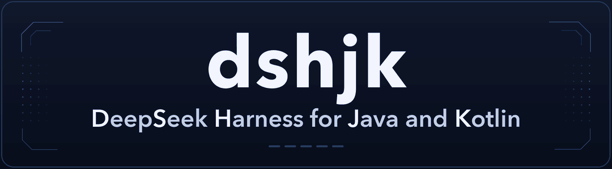

# dshjk: DeepSeek Harness for Java and Kotlin

**English** | [中文](README.zh.md)



Embed DeepSeek Harness in Java 17+ and Kotlin 2.2.0+ applications.

The SDK starts the native `dsh --profile sdk` runtime and communicates with it over bidirectional JSON-RPC 2.0 using JSON Lines. It supports multiple sessions, text and image inputs, native commands, session recovery, working directories, event subscriptions, approval requests, and user questions. Built-in event payloads, statuses, and finish reasons are typed. Kotlin uses suspending functions and Flow; Java uses blocking methods and JDK `Flow.Publisher` with the same types.

## Add the dependency

The SDK is available from Maven Central. Gradle and Maven use the same coordinates.

```kotlin
dependencies {
    implementation("com.elonzh:dshjk:0.2.0")
}
```

```xml
<dependency>
    <groupId>com.elonzh</groupId>
    <artifactId>dshjk</artifactId>
    <version>0.2.0</version>
</dependency>
```

## Bundle dsh with your application

The SDK can launch `dsh` from PATH or use an executable you specify through `HarnessConfig.runtime`. Set up your model and credentials in dsh before making model requests. The tested compatibility baseline is DeepSeek Harness `0.2.2-rc.1`.

To ship dsh with your application, add the optional runtime dependency and choose the classifier for your **deployment platform**: `linux-x64`, `linux-arm64`, `macos-x64`, `macos-arm64`, or `windows-x64`. The examples below use Linux x64. Runtime versions follow `<upstream dsh version>-<packaging revision>`.

```kotlin
dependencies {
    runtimeOnly("com.elonzh:dshjk-runtime:0.2.2-rc.1-1:linux-x64")
}
```

```xml
<dependency>
    <groupId>com.elonzh</groupId>
    <artifactId>dshjk-runtime</artifactId>
    <version>0.2.2-rc.1-1</version>
    <classifier>linux-x64</classifier>
    <scope>runtime</scope>
</dependency>
```

The SDK uses the explicitly configured command first, then the bundled dsh, then dsh on PATH. The bundled dsh includes Node and is extracted to `~/.cache/dshjk/runtime/<platform>/<runtime version>` on first launch. Set the JVM property `dshjk.runtime.cacheDir` to use a different cache root.

To upgrade the bundled dsh, change the `dshjk-runtime` dependency version. Each version is extracted to its own directory. You can remove an old cache directory after stopping all applications that use it.

## Kotlin

```kotlin
val harness = DeepSeekHarness()
try {
    val session = harness.session()
    session.run("Analyze this project", NotificationObserver { notification ->
        if (notification is HarnessNotification.Event && notification.sessionId == session.id) {
            when (val data = notification.event.data) {
                is SessionEventData.AssistantMessage -> {
                    data.message.content.filterIsInstance<ContentBlock.Text>().forEach { print(it.text) }
                    System.out.flush()
                }
                is SessionEventData.ToolCalled -> System.err.println("Tool: ${data.name}")
                is SessionEventData.TurnEnded -> System.err.println("Finished: ${data.reason.kind.wireName}")
                else -> Unit
            }
        }
    })
} finally {
    harness.closeAsync()
}
```

The complete [Kotlin example](examples/kotlin/src/main/kotlin/example/KotlinExample.kt) collects a `Flow` in a separate coroutine and handles text, tool, command, status, and subagent events. It uses the official `sdk` profile and the current working directory by default.

## Java

```java
try (var harness = new DeepSeekHarness()) {
    var session = harness.session();
    session.run("Analyze this project", notification -> {
        if (notification instanceof HarnessNotification.Event event && event.getSessionId().equals(session.getId())) {
            var data = event.getEvent().getData();
            if (data instanceof SessionEventData.AssistantMessage message) {
                for (var block : message.getMessage().getContent()) {
                    if (block instanceof ContentBlock.Text text) System.out.print(text.getText());
                }
                System.out.flush();
            } else if (data instanceof SessionEventData.ToolCalled call) {
                System.err.println("Tool: " + call.getName());
            } else if (data instanceof SessionEventData.TurnEnded turn) {
                System.err.println("Finished: " + turn.getReason().getKind().getWireName());
            }
        }
    });
}
```

The complete [Java example](examples/java/src/main/java/example/JavaExample.java) uses JDK `Flow.Subscriber` and shows how to request items, propagate errors, cancel, and drain the event queue. Java callers can use the SDK without `Continuation`, `runBlocking`, or a separate adapter.

## Sessions and configuration

`harness.run(input)` creates a new session with an ID in the official SDK format: `session-` followed by 32 hexadecimal UUID digits. To continue a conversation, keep the handle returned by `harness.session()` and call `session.run(input)` for each turn. Save the returned `sessionId` to resume the session later. You can also supply an explicit ID with `session(id)`.

Override the working directory, dsh home, or runtime command as needed:

```kotlin
val harness = DeepSeekHarness(HarnessConfig(
    cwd = Path.of("/path/to/workspace"),
    dshHome = Path.of("/path/to/isolated-home"),
    runtime = RuntimeCommand.node(Path.of("/path/to/@deepseek-ai/dsh/lib/bin.js")),
))
```

In Java, start with `HarnessConfig.builder()`, set any of `cwd`, `dshHome`, or `runtime`, then call `build()`.

See the [SDK guide](docs/sdk.md) for session recovery, event subscriptions, and the full configuration reference.

The SDK can also run DSH CLI profiles and store native attachments for agent inputs. See the [command and attachment APIs](docs/sdk.md#dsh-commands-and-attachments).

## Spring Boot 4 and Spring AI

Add the optional [Spring Boot starter](docs/spring.md#add-the-starter) to inject a Spring-managed `DeepSeekHarness`.

The starter preserves native defaults and supports typed startup patches and provider settings, bean overrides, and callback injection. It closes the runtime when the application context shuts down. If you haven't configured a model explicitly, it can reuse connection settings from an existing Spring AI OpenAI or Anthropic `ChatModel`. The starter configures the native runtime to reach Spring AI `@Tool` and `ToolCallbackProvider` tools through the official MCP server.

See the [Spring integration guide](docs/spring.md) for setup and configuration. The [Spring Boot example](examples/spring-boot/src/main/kotlin/example/spring/HarnessApplication.kt) shows tool registration, HTTP requests, and server-sent events.

## Development

Use JDK 17 and Node.js 24.9+. Install the pinned dsh release, then build and test the SDK, Spring starter, and examples:

```sh
npm ci --prefix libs/dshjk-runtime
DSHJK_TEST_CLI="$PWD/libs/dshjk-runtime/node_modules/@deepseek-ai/dsh/lib/bin.js" ./gradlew build
```

To run just the core SDK tests, use `./gradlew :dshjk:test`. Model integration tests use local HTTP fixtures.

The [Build dsh runtime](.github/workflows/runtime.yml) workflow builds a runtime JAR for each platform. Start at packaging revision `1` for each upstream version and increment it when repackaging that same upstream version.

This project uses the [Apache License 2.0](LICENSE). See [NOTICE](NOTICE) for third-party notices.
