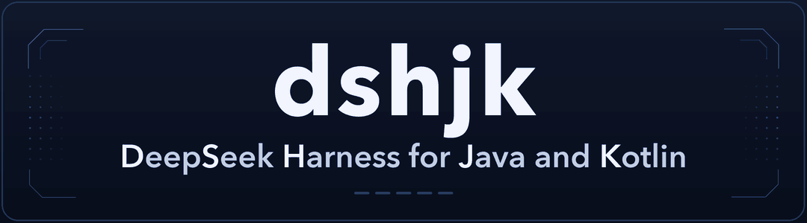

# dshjk: DeepSeek Harness for Java and Kotlin

[English](README.md) | **中文**



DeepSeek Harness 的 JVM SDK，适用于 Java 17+ 和 Kotlin 2.2.0+ 应用。

SDK 直接启动原生 `dsh --profile sdk`，通过双向 JSONL JSON-RPC 2.0 通信。支持多 Session、文本/图片、原生命令、持久化恢复、工作目录、事件订阅、审批和用户问题；内置事件载荷、状态与结束原因均提供类型化定义。Kotlin 使用 suspend/Flow；Java 在同一类型上使用阻塞方法和 JDK `Flow.Publisher`。

## 添加依赖

SDK 可从 Maven Central 获取。Gradle 和 Maven 使用相同的制品坐标。

```kotlin
dependencies {
    implementation("com.elonzh:dshjk:0.1.0")
}
```

```xml
<dependency>
    <groupId>com.elonzh</groupId>
    <artifactId>dshjk</artifactId>
    <version>0.1.0</version>
</dependency>
```

## 随应用交付 dsh

SDK 可直接启动 PATH 上的 `dsh`，也可以通过 `HarnessConfig.runtime` 指定可执行文件。使用模型前请在 dsh 中配置模型和凭据。当前兼容基线是 DeepSeek Harness `0.2.2-rc.1`。

如果希望应用自带 dsh，添加可选运行时依赖，并按**部署平台**选择 classifier。支持 `linux-x64`、`linux-arm64`、`macos-x64`、`macos-arm64` 和 `windows-x64`。以下以 Linux x64 为例。运行时版本格式为 `<上游 dsh 版本>-<打包修订号>`。

```kotlin
dependencies {
    runtimeOnly("com.elonzh:dshjk-runtime:0.2.2-rc.1-1:linux-x64")
}
```

```xml
<dependency>
    <groupId>com.elonzh</groupId>
    <artifactId>dshjk-runtime</artifactId>
    <version>0.2.2-rc.1-1</version>
    <classifier>linux-x64</classifier>
    <scope>runtime</scope>
</dependency>
```

默认启动顺序为显式配置、随包的 dsh、PATH 上的 dsh。随包的 dsh 自带 Node，首次启动时解压到 `~/.cache/dshjk/runtime/<平台>/<运行时版本>`。可用 JVM 属性 `dshjk.runtime.cacheDir` 指定其他缓存根目录。

升级随包的 dsh 时，更新 `dshjk-runtime` 依赖版本。新版首次启动时会解压到自己的目录。旧缓存可以在使用它的应用全部停止后删除。

## Kotlin

```kotlin
val harness = DeepSeekHarness()
try {
    val session = harness.session()
    session.run("帮我分析这个项目", NotificationObserver { notification ->
        if (notification is HarnessNotification.Event && notification.sessionId == session.id) {
            when (val data = notification.event.data) {
                is SessionEventData.AssistantMessage -> {
                    data.message.content.filterIsInstance<ContentBlock.Text>().forEach { print(it.text) }
                    System.out.flush()
                }
                is SessionEventData.ToolCalled -> System.err.println("工具：${data.name}")
                is SessionEventData.TurnEnded -> System.err.println("结束：${data.reason.kind.wireName}")
                else -> Unit
            }
        }
    })
} finally {
    harness.closeAsync()
}
```

完整 [Kotlin 示例](examples/kotlin/src/main/kotlin/example/KotlinExample.kt) 使用独立协程收集 `Flow`，处理文本、工具、命令、状态与子 Agent 事件。默认使用官方 `sdk` profile 和当前工作目录。

## Java

```java
try (var harness = new DeepSeekHarness()) {
    var session = harness.session();
    session.run("帮我分析这个项目", notification -> {
        if (notification instanceof HarnessNotification.Event event && event.getSessionId().equals(session.getId())) {
            var data = event.getEvent().getData();
            if (data instanceof SessionEventData.AssistantMessage message) {
                for (var block : message.getMessage().getContent()) {
                    if (block instanceof ContentBlock.Text text) System.out.print(text.getText());
                }
                System.out.flush();
            } else if (data instanceof SessionEventData.ToolCalled call) {
                System.err.println("工具：" + call.getName());
            } else if (data instanceof SessionEventData.TurnEnded turn) {
                System.err.println("结束：" + turn.getReason().getKind().getWireName());
            }
        }
    });
}
```

完整 [Java 示例](examples/java/src/main/java/example/JavaExample.java) 使用 JDK `Flow.Subscriber`，展示 demand、错误传播、取消和队列排空。Java 无需 Continuation、runBlocking 或额外语言适配包。

## 会话与配置

`harness.run(input)` 自动创建独立会话，ID 遵循官方 SDK 的 `session-<32 位十六进制 UUID>` 格式。要连续对话，保留 `harness.session()` 返回的句柄并多次调用 `session.run(input)`；结果中的 `sessionId` 可用于后续恢复。也可通过 `session(id)` 使用显式 ID。

按需覆盖工作目录、home 或运行时路径：

```kotlin
val harness = DeepSeekHarness(HarnessConfig(
    cwd = Path.of("/path/to/workspace"),
    dshHome = Path.of("/path/to/isolated-home"),
    runtime = RuntimeCommand.node(Path.of("/path/to/@deepseek-ai/dsh/lib/bin.js")),
))
```

Java 使用 `HarnessConfig.builder()`，按需设置 `cwd`、`dshHome` 或 `runtime`，再调用 `build()`。

会话恢复、事件订阅与完整配置见 [SDK 文档](docs/sdk.zh.md)。

SDK 也支持运行 DSH CLI profile，并为 Agent 输入存取原生附件。用法见[命令与附件 API](docs/sdk.zh.md#dsh-命令与附件)。

## Spring Boot 4 与 Spring AI

添加可选 [Spring Boot Starter](docs/spring.zh.md#使用-starter) 后，可直接注入由 Spring 管理的 `DeepSeekHarness`。

starter 保留原生默认行为，支持数据类 patch、类型化供应商配置、Bean 覆盖、回调注入和容器关闭时的进程回收。未显式配置模型时，可从现有 Spring AI OpenAI / Anthropic ChatModel 提取连接配置。Spring AI 的 `@Tool` / `ToolCallbackProvider` 经官方 MCP Server 接入 Harness；连接配置由 starter 转为原生启动 patch。

[Spring 集成文档](docs/spring.zh.md)包含完整配置与用法；[Spring Boot 示例](examples/spring-boot/src/main/kotlin/example/spring/HarnessApplication.kt)提供工具注册、普通 HTTP 请求和 SSE 事件输出。

## 开发

使用 JDK 17 和 Node.js 24.9+。安装仓库锁定的 dsh 后，运行 SDK、Spring 和示例的测试。

```sh
npm ci --prefix libs/dshjk-runtime
DSHJK_TEST_CLI="$PWD/libs/dshjk-runtime/node_modules/@deepseek-ai/dsh/lib/bin.js" ./gradlew build
```

单独运行核心 SDK 测试用 `./gradlew :dshjk:test`。模型集成测试使用本地 HTTP 夹具。

运行时 JAR 由 [Build dsh runtime](.github/workflows/runtime.yml) 按平台构建。每个上游版本首次发布时使用修订号 `1`，同一上游版本重新打包发布时递增。

项目使用 [Apache License 2.0](LICENSE)。第三方声明见 [NOTICE](NOTICE)。
