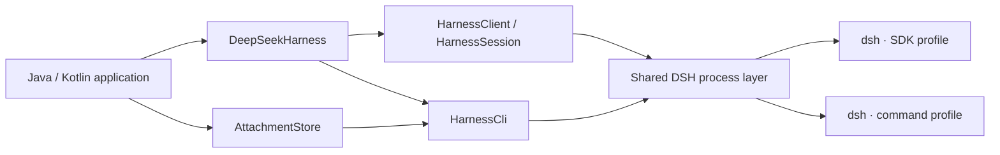

# SDK usage and architecture

**English** | [中文](sdk.zh.md)

## Boundaries and dependencies

`libs/dshjk` is the JVM SDK for Kotlin and Java applications. `libs/dshjk-spring-boot-starter` provides optional Spring integration. See the [README](../README.md#add-the-dependency) to add the dependency and the [Spring integration guide](spring.md) to configure Spring and connect its tools.



`configuration` defines launch inputs, and `runtime/internal` handles process startup, termination, and temporary files. `client/internal` handles stdio JSON-RPC, request correlation, callbacks, and event delivery. `DeepSeekHarness` manages initialization and closure, and `HarnessSession` collects the activity associated with an input. The Java blocking methods delegate to the Kotlin suspending methods.

An SDK profile child process can host multiple agent sessions for one harness. The runtime owns the agent loop, session history, model routing, tools, approval policies, working directories, goals and plans, and persistence. The SDK tracks initialization, pending RPCs, session handles, and notification subscriptions. `DeepSeekHarness()` works with the default configuration. `session()` creates a lazy handle and generates an ID in the official SDK format: `session-` followed by 32 hexadecimal UUID digits. Reusing the handle continues the same session. `run(input)` creates a new session each time; `session(id)` uses the ID supplied by the caller. The protocol requires an ID in each session request, so the SDK generates it when it creates the handle, as the official client does.

## SDK operations

| Native request | Shared Java and Kotlin API | Result or behavior |
| --- | --- | --- |
| `initialize` | `HarnessClient.initialize` | Returns `InitializeResult` and checks the server identity |
| `session/prompt` | `prompt` | Returns a `PromptReceipt`; queues input directly, bypassing command routing |
| `session/query` | `query` | Returns `QueryResult.Prompt` or `QueryResult.Command` |
| `session/resume` | `resumeSession` | Restores a persisted session without sending new input |
| `session/wait` | `waitForSession` | Waits for the owned session and its managed descendants |
| `session/working-directory/get` | `getWorkingDirectory` | Returns the effective absolute working directory |
| `session/working-directory/set` | `setWorkingDirectory` | Changes the working directory and returns the effective path |
| `shutdown` | `shutdown` | Shuts down the protocol; `close` also reclaims the process |

Initialize the client before sending low-level requests. The high-level API starts and initializes the runtime on first use via `DeepSeekHarness.start()`. Concurrent callers share one handshake. If initialization fails, the SDK closes the process and leaves the instance in a terminal state. Correct the configuration and create a new instance. Closing can interrupt a pending handshake. The SDK does not retry submitted inputs automatically.

`HarnessClient.request(SdkRequestMethod, ...)` provides typed names for built-in methods. The string overload calls methods added by a profile and uses `JsonObject` and `JsonElement` for extension payloads. `RpcException` preserves the remote `code`, message, and data. `ProtocolException` indicates an invalid known protocol field. `RequestTimeoutException` means a local wait timed out. `TransportClosedException` includes the profile, process status, and up to 64 KiB from the end of stderr.

## Input, receipts, and completion

`session.run(text)` and `session.run(List<ContentBlock>)` send input through native `session/query`, which parses the command syntax. The SDK provides types for text, reasoning, encoded images, persisted image and file references, tool calls, tool additions, and tool removals. Plugins can add blocks through `ContentBlock.Extension`. Send images as base64 with a supported MIME type and use a model that accepts images. The runtime validates and persists the image content.

```kotlin
val input = listOf(
    ContentBlock.Text("Analyze this image"),
    ContentBlock.EncodedImage(base64, ImageMediaType.IMAGE_PNG, "screenshot.png"),
)
val result = session.run(input)
```

For ordinary input, `messageId` acknowledges that the input was persisted and queued. `run` subscribes before sending the request and ignores notifications preceding that message's `agent/inbox/spliced` event. It then receives notifications from the root session and known descendants until the root agent goes `idle`. The result's `events` list contains only root session events, so subagent text cannot replace the root response. `finalResponse` joins the text blocks of the root session's last assistant message. `finishReason` represents the last `turn/end.reason.kind` as a `FinishReason`, such as `FinishReason.Builtin.COMPLETED`.

The SDK correlates `command/run`, `command/done`, and `session.query.completed` by `commandId`. For native commands, `run` waits for the command activity to end. This works with commands that need no model activity, such as `/permission` and `/compact`, and commands that can start further activity, such as `/plan` and `/goal`. Missing lifecycle events raise a protocol error. If the runtime rejects a command, the result reports the rejection. The profile determines which commands are available.

Inputs to different sessions or to the same session can overlap. Each call has its own subscription, so it does not compete with other calls for items in a shared queue. An ordinary input's activity window can include overlapping work in the same session, as in the official SDK. The observer runs synchronously in notification order. If it throws, collection ends and the subscription is released; work already submitted to the runtime continues.

Use `runStreaming(input, observer)` in Kotlin or Java to process events individually and get a `RunSummary` containing the session ID, final text, and finish reason. Use `run()` to get a `RunResult` that also retains the events and notifications from the run.

## Event subscriptions

The native SDK emits recorded `session.event` events and status notifications. Assistant text arrives in an `assistant/message` event after each model step finishes. `AssistantMessage.stream` records chunks from that model attempt; it does not deliver live token deltas. Print or display each message as it arrives and handle tool calls, tool results, and status changes alongside it.

The runnable [Kotlin Flow example](../examples/kotlin/src/main/kotlin/example/KotlinExample.kt) and [Java JDK Publisher example](../examples/java/src/main/java/example/JavaExample.java) subscribe before starting `runStreaming()`. They print root session text and any command output to stdout, and tool, command, subagent, status, and finish details to stderr. Once the input finishes, they close the runtime, drain the notifications already received, and release the subscription. The examples treat `TransportClosedException` during normal shutdown as the end of the stream and propagate other subscription errors. The event handler has already printed the text, so the examples do not print `finalResponse` again.

Each of the six known SDK notifications has its own type: `Event`, `Status`, `QueryCompleted`, `SubagentStarted`, `SubagentFinished`, and `QuestionCancelled`. The `method` field uses `NotificationMethod`. Known methods are `NotificationMethod.Builtin` enum values; new methods use `Extension`. Every notification retains its original params.

`SessionEvent.type` uses `SessionEventType`, with all 63 event names from the supported baseline defined in `SessionEventType.Builtin`. The sealed `SessionEventData` interface has a data class for each built-in event. Typed fields cover turns and steps, messages and streams, tool calls, commands, approvals, compaction, goals, todos, jobs, and teams. `seq` and `time` are validated integers. `raw` retains the full native envelope, including surface metadata and unknown fields.

Fixed sets of values use enums such as `AgentStatus`, `RunStatus`, `CommandStatus`, `TodoStatus`, `JobStatus`, `GoalPhase`, and `ImageMediaType`. `TurnEndReason` and `QuestionIntent` use sealed types with payloads: `TurnEndReason.Aborted` carries an `AbortReason`, `TurnEndReason.Error` carries an `LlmFailure`, and `QuestionIntent.PlanReview` carries approval options and a call ID. Image and file references use `ImageAttachment` and `FileAttachment`.

Event names, notification methods, finish reasons, and content block types that the runtime allows plugins to extend use built-in enums plus an `Extension` type. Unknown values retain their original name and JSON. Invalid or missing fields on known types raise `ProtocolException`. Use `.wireName` to get the exact protocol spelling. Open-ended metadata such as tool arguments, JSON Schema, provider replay state, and plugin-specific message sources remains JSON.

In Kotlin, branch on the payload type:

```kotlin
when (val data = event.data) {
    is SessionEventData.ToolCalled -> println(data.name)
    is SessionEventData.TurnEnded -> println(data.reason.kind.wireName)
    is SessionEventData.TodosWritten -> data.todos.forEach { println(it.status) }
    else -> Unit
}
```

In Java 17, use `event.getData() instanceof SessionEventData.ToolCalled call` and read `call.getName()`. Compare fixed statuses directly with enum values. For plugin events, read the original value through `SessionEventData.Extension` or use `decodeData(serializer)` to decode it into a plugin-specific type. The SDK leaves native session logs in their original format.

A subscription registers when created and has its own buffer, which defaults to 8,192 items. Overflow raises `SlowConsumerException` only on that subscription and does not block protocol reads. If the process exits, the subscription delivers buffered notifications before reporting the terminal error. Closing a subscription discards its queue. A `next(Duration)` timeout ends just that wait; the subscription remains usable.

In Kotlin:

```kotlin
val subscription = harness.client.subscribe(session.id) // Root session and known descendants
try {
    subscription.events.collect { notification -> /* Update the UI */ }
} finally {
    subscription.close()
}
```

In a production application, start the input in a separate coroutine and keep consuming the subscription. For feedback on a single high-level `run` call, pass a `NotificationObserver` directly.

In Java, create a `NotificationSubscription` and call `subscription.events().subscribe(Flow.Subscriber)` to consume events with JDK Publisher backpressure. Use `next()` for blocking reads. Each subscription serves one consumer; create a separate subscription for each additional consumer. Cancelling the Publisher subscription cancels its wait. The owner should still close the `NotificationSubscription`.

The SDK tracks the session tree through `subagent.started`, including descendants discovered before a subscription was created. It clears the process-wide session tree during shutdown. It cannot infer the lifecycle of remote agents that emit no upstream notifications.

## Approvals and user questions

Install callbacks when building the configuration. High-level initialization advertises their capabilities automatically; callers using low-level `initialize` must declare them explicitly. Without a callback, the native answerer chain stays in control. The SDK does not select answers on its own.

```kotlin
val config = HarnessConfig(
    dshHome = home,
    approvalHandler = ApprovalHandler { request, cancellation ->
        // Show request.toolName and reason in your UI; return ALLOWED_ONCE only after explicit approval
        ApprovalResult(ApprovalOutcome.REJECTED)
    },
    userQuestionHandler = UserQuestionHandler { request, cancellation ->
        UserQuestionResult.Answer(listOf(AnswerItem(request.questions.single().id, listOf("CSV"))))
    },
)
```

In Java, use the builder methods of the same names and the same functional interfaces. `approval/request` returns `ALLOWED_ONCE`, `REJECTED`, or `CANCELLED`. A one-time approval does not persist permission. `user-question/ask` returns `Answer` or `UserQuestionResult.Cancelled` (use `INSTANCE` in Java). Answer each original question ID exactly once. Cancellation does not grant approval.

Callbacks can run concurrently on separate I/O threads and can make nested SDK requests. The thread reading the protocol does not wait for the UI. On `user-question.cancelled` or connection close, the SDK sets `CancellationToken.isCancelled` and interrupts the callback thread. The host should release any UI or resources associated with the wait promptly. A callback exception returns an RPC error. The runtime does not use answers submitted after cancellation. Host code that ignores interruptions may continue running; shutdown does not wait indefinitely for it.

## Configuration and lifecycle

| Setting | Default or purpose |
| --- | --- |
| `dshHome` | Optional; an explicit value takes precedence, otherwise the runtime checks `DSH_HOME` and then `~/.dsh` |
| `runtime` | Explicit command first, then the [bundled runtime](../README.md#bundle-dsh-with-your-application), then `dsh` on PATH |
| `profile` | `sdk`, the native runtime composition |
| `patches` / `patchFiles` | Both empty; inline typed operations followed by raw patch files |
| `cwd` / `processCwd` | The JVM working directory / `cwd`; the agent workspace and child process directory, respectively |
| `environment` / `inheritEnvironment` | Empty / true; overrides the inherited environment, or replaces it entirely when inheritance is disabled. An explicit `dshHome` overrides the child's `DSH_HOME` |
| `provider` / `model` | `deepseek-official` / `deepseek-v4-flash` |
| `reasoningEffort` / `maxTokens` | Unset to use adapter defaults; when set, provide a nonblank value and a positive integer, respectively |
| `initializeTimeout` | 30 seconds for the initial profile handshake |
| `requestTimeout` | Unbounded by default. Limits the time to send the RPC and receive its response; later agent activity has its own lifecycle |
| `shutdownTimeout` / `eofGrace` / `terminateGrace` | 1 / 6 / 3 seconds |
| `notificationBufferCapacity` | 8,192 items per subscription |

All timeouts use `java.time.Duration`. Use `HarnessConfig(requestTimeout = Duration.ofSeconds(45))` in Kotlin or `HarnessConfig.builder().requestTimeout(Duration.ofSeconds(45)).build()` in Java.

Build the configuration with `HarnessConfig()` or Java's `HarnessConfig.builder()`; all settings are optional. The SDK makes immutable copies of collections and snapshots inline patch JSON when building the configuration. If `dshHome` is unset, the SDK preserves the child process environment and lets the runtime resolve its home, including handling blank variables and expanding `~`. Arguments are passed directly as argv without shell interpretation. Use `RuntimeCommand.of` for an explicit launcher prefix, such as a custom Node loader. The SDK does not modify the host environment.

Kotlin's `closeAsync()` and Java's `close()` (including try-with-resources) use the same shutdown implementation. Closing a harness cancels active CLI and attachment calls. The RPC client stops host callbacks, tries to send `shutdown`, and allows the runtime to clean up after stdin reaches EOF. The process layer terminates processes that remain active, including descendants visible during termination, and confirms they have exited. Plugins own the resources they create. Closing is idempotent and terminal, and Kotlin shutdown runs in `NonCancellable`.

A local request timeout or coroutine cancellation withdraws any send that has not started, removes the pending request, and ignores late responses. The runtime can still execute a request once writing has started. Close the owner to stop the entire runtime. The SDK exposes no session abort operation.

Use the original home with `resumeSession(id)`. The runtime reports missing, locked, or incompatible history rather than creating a replacement session. Resuming does not restore previous shell or browser processes. The working directory operations can create a session lazily. Relative paths resolve against the session's current directory. Setting it leaves the original directory metadata, permissions, and existing external processes unchanged.

## Typed patches and provider configuration

A `HarnessPatch` describes one native Cordis operation: `id + config` replaces the entire configuration of an existing entry, `id + disabled` changes its enabled state, and `insert` inserts `HarnessPlugin` entries. With an `id`, insertion targets that group. `name` is a match criterion for an existing entry. Plugin configuration is a map of JSON values, so plugins can define their own fields.

Use the typed `LlmProviderConfig`, `LlmModelConfig`, and `LlmApi` to configure a provider directly in code:

```kotlin
val config = HarnessConfig(
    provider = "gateway",
    model = "my-model",
    environment = mapOf("GATEWAY_API_KEY" to requireNotNull(System.getenv("GATEWAY_API_KEY"))),
    patches = listOf(HarnessPatch.providers(mapOf(
        "gateway" to LlmProviderConfig(
            api = LlmApi.OPENAI_COMPLETIONS,
            baseUrl = URI.create("https://gateway.example/v1"),
            apiKeyEnv = "GATEWAY_API_KEY",
            models = listOf(LlmModelConfig("my-model", contextWindow = 131072, maxTokens = 8192)),
        ),
    ))),
)
```

Use the model ID and limits supplied by your provider. `apiKeyEnv` names a key in the child process environment or native credential store; keep the secret value out of the provider patch. `LlmApi` also supports `OPENAI_RESPONSES` and `ANTHROPIC_MESSAGES`. The default `sdk` profile already contains an `llm-pi-ai` entry. For `sdk-minimal`, use `HarnessPatch.providers(..., insertAdapter = true)` to insert the adapter. For a custom profile, choose replacement or insertion based on its composition.

Configure MCP through the same API. The native client manages the connection:

```kotlin
val patch = HarnessPatch.mcpServers(mapOf(
    "external" to McpServerConfig(URI.create("http://127.0.0.1:8080/mcp")),
))
val config = HarnessConfig(patches = listOf(patch))
```

For other plugins, use the data classes directly:

```kotlin
HarnessPatch(id = "terminal-bash", disabled = true)
HarnessPatch(insert = listOf(HarnessPlugin(
    id = "my-plugin",
    name = "@example/dsh-plugin",
    config = mapOf("enabled" to true, "limit" to 10),
)))
```

In Java, use the same constructors, `HarnessPatch.providers(...)`, `HarnessPatch.mcpServers(...)`, and the builder's `patches(...)` method.

For existing YAML or JSON files, use `HarnessConfig(patchFiles = listOf(Path.of("tools.patch.yml")))` or `builder.patchFiles(...)`. On first process launch, the SDK writes the inline operations to one JSON file in a private temporary directory, then passes the files from `patchFiles` in order. This lets those files override inline operations. The SDK cleans up generated files if launch fails and after the child process has exited during shutdown, including when initialization fails or `close()` follows an unexpected exit. The caller owns user-supplied files. Each client owns its generated files; building a config or starting the Spring context does not generate them.

Keep persistent tool and MCP configuration in the profile. Patches supplied in a client's configuration take effect on its next launch. The runtime replaces the entire configuration of an overridden entry, so include every provider you want to keep when overriding `llm-pi-ai`.

## DSH commands and attachments

`harness.cli.execute(ProfileInvocation(...))` runs a DSH profile. RPC and CLI share the executable, `processCwd`, environment, and `DSH_HOME` settings. DSH composes plugins from the profile, home, and launch patches. Each CLI invocation specifies its own inline patches and patch files, applied in that order. Arguments after `--` reach the application plugin.

```kotlin
import com.elonzh.dshjk.configuration.ProfileInvocation

val result = harness.cli.execute(ProfileInvocation("headless", listOf("--help")))
check(result.exitCode == 0) { result.stderr }
println(result.stdout)
```

`execute` provides empty stdin by default or reads from an `input: Path`. It captures UTF-8 stdout and stderr up to 1 MiB each. With an `output: Path`, stdout goes directly to that file and the result's `stdout` is `null`. A failed command may leave partial output in that file. An ordinary exit returns a `CliResult`, including nonzero exit codes. Launch or capture failures throw `CliException`. A timeout throws `RequestTimeoutException` and defaults to 30 seconds.

Each command launches a process and can run before the SDK session process starts.

Install plugins in a DSH profile or add them for a single launch with `ProfileInvocation.patches`. A command plugin reads `ctx.cmdlineArgs`, runs after `ctx.appReady`, and exits via `ctx.appExit`. [DSH CLI plugin guide](https://github.com/deepseek-ai/deepseek-harness/blob/master/docs/user/develop/basic/publish.md#give-a-surface-bundle-its-own-command-line)

### Store and retrieve attachments

Create an `AttachmentStore(harness)` to opt in when using `sdk` or `sdk-minimal`. Each command reuses the SDK profile and patches in a separate process and accesses that profile's `attachments` service. To use a custom command profile that provides this service, pass `harness.cli` and a `ProfileInvocation` with empty application arguments to `AttachmentStore`. The store supplies the command arguments and owns standard I/O. Recreate the harness after changing storage configuration on disk so sessions and newly launched commands use the same settings.

```kotlin
import com.elonzh.dshjk.attachment.AttachmentStore

val config = HarnessConfig(dshHome = Path.of("/data/dsh"), profile = "sdk-minimal")
DeepSeekHarness(config).use { harness ->
    val attachments = AttachmentStore(harness)
    val image = attachments.saveImage(Path.of("screenshot.png"), ImageMediaType.IMAGE_PNG)
    val file = attachments.saveFile(Path.of("data.csv"))
    harness.run(listOf(ContentBlock.Text("Inspect these attachments"), ContentBlock.Image(image), ContentBlock.File(file)))
    attachments.readFile(file, Path.of("download.csv"))
}
```

Save operations return native DSH attachment references. DSH validates and normalizes images and preserves ordinary file bytes. A read replaces the destination after successful verification. `AttachmentException.code` preserves native codes such as `INVALID_IMAGE`, `ATTACHMENT_NOT_FOUND`, and `ATTACHMENT_CORRUPT`. DSH presents ordinary files to the model as references. Reading their contents requires a tool that can handle the file. The host application owns authorization, quotas, and retention.

When the upload is already a stream, call `saveFile(InputStream, name)` or `saveImage(InputStream, mediaType[, name])`. The SDK sends chunks from the stream's current position to DSH stdin without creating a local copy of the upload. DSH reads and normalizes images within its configured limits. Use the `Path` overloads for an existing local file.

For example, a Java multipart handler can pass the uploaded part's stream directly:

```java
try (var input = part.getInputStream()) {
    return attachments.saveFile(input, part.getSubmittedFileName());
}
```

The caller closes the stream; Kotlin callers can use `use { ... }`. Attachment commands time out after 30 seconds by default. Cancellation stops the DSH process, but an in-progress `InputStream.read` returns according to the stream implementation. Configure read timeouts for network sources so the call can finish promptly.

### Serve a stored image

`openImage(ImageAttachment)` returns an `InputStream` for the verified, normalized image. Set the response headers from the attachment reference, and close the stream to remove its temporary copy.

```java
try (var stream = attachments.openImage(image)) {
    response.setContentType(image.getMediaType().getWireName());
    response.setContentLengthLong(image.getBytes());
    stream.transferTo(response.getOutputStream());
}
```

In Kotlin, call the suspending `openImage` and close it with `use { ... }`.

### Download a file by attachment ID

Persist the `FileAttachment` returned by `saveFile` with the application record that grants access to the file. DSH reads a reference containing the ID, filename, and byte count. Identical bytes can have the same ID under multiple filenames, so resolve the reference within the current request's authorized scope. [DSH attachment store contract](https://github.com/deepseek-ai/deepseek-harness/blob/fcc0ad4621/packages/attachment/attachment/src/index.ts)

The Java blocking API can be used in a download handler as follows. `fileLookup` supplies the reference for the current request and returns `null` when the file is unavailable. Map `AttachmentException` with code `ATTACHMENT_NOT_FOUND` to a 404 before writing the response.

```java
try (var stream = attachments.openFile(attachmentId, fileLookup)) {
    response.setContentType("application/octet-stream");
    response.setContentLengthLong(stream.getAttachment().getBytes());
    stream.transferTo(response.getOutputStream());
}
```

`openFile(FileAttachment)` also accepts a reference the caller has already resolved. Both overloads return a stream after DSH verifies the bytes into a private temporary file. Closing the stream removes the file. This lets the handler report verification failures before sending headers and keeps download memory usage independent of file size. Kotlin uses the suspending overloads with `use { ... }`.

## Compatibility and verification

The protocol baseline is upstream commit `fcc0ad4621` and the public npm CLI `@deepseek-ai/dsh@0.2.2-rc.1`. The upstream `packages/sdk/protocol/src/types.ts` defines the wire contract, and the high-level activity handling follows the TypeScript and Python SDKs from that version. The library does not require an exact runtime version match; verification covers this baseline.

Local tests cover JDK 17 and 21, Java and Kotlin consumers, bidirectional RPC, Unicode, command correlation, concurrent sessions, independent subscriptions and overflow, nested requests from callbacks, cancellation and timeouts, stderr, handshake failures, unexpected exits, and forced termination. Tests with the unmodified CLI and a local Messages HTTP fixture cover model requests, concurrency, automatic session IDs and recovery, working directories, home discovery, and configuration precedence under `sdk-minimal`. They also exercise permissions, compaction, token limits, and user questions under `sdk`.

SDK build CI uses JDK 17 and 21 on Linux. A separate runtime packaging workflow targets Linux, macOS, and Windows. Local runs cover macOS. Cloud model endpoints, Windows and Linux runtime behavior, image persistence, and specific external tools still need verification in their respective environments. See the [Spring guide](spring.md) for integration tests with a real MCP server and a local OpenAI-compatible endpoint.
