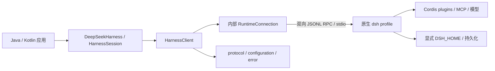

# SDK 使用与架构

## 边界与依赖

`dshjk` 是面向 Java 和 Kotlin 应用的 DeepSeek Harness JVM 客户端。仅发布 `libs/dshjk`；`examples/java` 与 `examples/kotlin` 是独立编译的消费示例。



`protocol` 定义 wire 模型和边界解析；`configuration` 定义启动参数；`client/internal` 独占进程、stdio、RPC 关联、回调与事件分发。`HarnessClient` 暴露协议操作，`DeepSeekHarness` 负责一次初始化，`HarnessSession` 负责输入活动的收集。两种语言共享这些类型和实现；Java 阻塞入口委托 suspend 方法，使用 `@JvmSynthetic` 隐藏 Continuation 签名。

一个 Harness 对应一个子进程，可管理多个 Session。运行时拥有 Agent loop、Session history、模型路由、工具、审批策略、工作目录、goal/plan 状态及持久化；SDK 仅保存初始化状态、RPC 等待项、Session 句柄和通知订阅。`session(id)` 是惰性句柄；相同 id 对应同一原生会话，新的独立任务应使用不同 id。

## 完整 SDK 操作

| 原生请求 | Java/Kotlin 同一 API | 返回/语义 |
| --- | --- | --- |
| `initialize` | `HarnessClient.initialize` | `InitializeResult`，校验 server identity |
| `session/prompt` | `prompt` | `PromptReceipt`，直接入队，绕过命令路由 |
| `session/query` | `query` | `QueryResult.Prompt` 或 `QueryResult.Command` |
| `session/resume` | `resumeSession` | 恢复已持久化会话，无新输入 |
| `session/wait` | `waitForSession` | 等待已拥有会话及其受管理后代 |
| `session/working-directory/get` | `getWorkingDirectory` | 当前有效绝对目录 |
| `session/working-directory/set` | `setWorkingDirectory` | 改变当前目录，返回有效目录 |
| `shutdown` | `shutdown` | 协议关闭；`close` 还会回收进程 |

低层请求前须初始化。高层 `DeepSeekHarness.start()` 在首次调用时自动完成初始化，并发调用共享一次握手；失败时关闭进程并将实例置为终态，修正配置后创建新实例。关闭可以打断仍在等待的握手。库不会自动重试已发出的输入。

`HarnessClient.request(SdkRequestMethod, ...)` 提供内置方法名的类型化入口；字符串重载可调用 profile 新增的方法，使用 `JsonObject` / `JsonElement` 保留扩展载荷。`RpcException` 保留远端 `code`、message、data；`ProtocolException` 表示收到的已知字段不符合协议；`RequestTimeoutException` 表示本地等待超时；`TransportClosedException` 带 profile、进程状态及最多 64 KiB stderr 尾部。

## 输入、回执与完成

`session.run(text)` 或 `session.run(List<ContentBlock>)` 将输入交给原生 `session/query`，不在 JVM 重写命令语法。文本、reasoning、编码图片、持久化图片/文件引用、tool-call、tool-addition、tool-removal 均有类型；插件新增块可用 `ContentBlock.Extension`。图片使用 base64 和受支持的 MIME，实际内容校验与持久化由运行时完成，模型必须支持图片。

```kotlin
val input = listOf(
    ContentBlock.Text("分析这张图"),
    ContentBlock.EncodedImage(base64, ImageMediaType.IMAGE_PNG, "screenshot.png"),
)
val result = session.run(input)
```

普通输入的 `messageId` 只是持久化入队回执。`run` 在发请求前订阅，忽略该 message 的 `agent/inbox/spliced` 之前的通知，之后持续收到根 Session 与已知后代通知，直到根 Agent `idle`。结果中 `events` 只含根 Session，子 Agent 的文本不会覆盖根回复。`finalResponse` 是最后一条根 assistant message 中 text 的拼接；`finishReason` 使用 `FinishReason` 表达最后一条 `turn/end.reason.kind`，例如 `FinishReason.Builtin.COMPLETED`。

原生命令按 `commandId` 关联 `command/run`、`command/done` 与 `session.query.completed`。`run` 等待命令活动结束而非单独等待 idle，因而适用于无模型活动的 `/permission`、`/compact`，以及可启动后续活动的 `/plan`、`/goal`。缺失配对生命周期事件会抛协议错误；原生命令拒绝通过结果返回。具体命令是否可用由 profile 决定。

多个 Session 或同 Session 的输入可以重叠；每次调用持有独立订阅，不会竞争消费同一队列。普通输入的活动区间可能包含同 Session 的重叠工作，与官方 SDK 一致。observer 按接收顺序同步执行；其异常结束本次收集并释放订阅，不撤销已提交给运行时的工作。

## 事件订阅

六个已知 SDK 通知都有独立类型：`Event`、`Status`、`QueryCompleted`、`SubagentStarted`、`SubagentFinished`、`QuestionCancelled`。`method` 使用 `NotificationMethod`；内置方法是 `NotificationMethod.Builtin` 枚举，新增通知使用 `Extension`，所有通知保留原始 params。

`SessionEvent.type` 使用 `SessionEventType`，当前基线的 63 个内置名称集中定义在 `SessionEventType.Builtin`；`data` 使用 sealed 接口 `SessionEventData`，每个内置事件对应具体数据类。turn/step、消息与流、工具调用、命令、审批、compaction、goal、todo、job、team 等都可直接读取类型化字段。`seq`、`time` 是经过校验的整数；完整原生 envelope（含 surface metadata 和未知字段）仍保留在 `raw` 中。

固定状态使用枚举，例如 `AgentStatus`、`RunStatus`、`CommandStatus`、`TodoStatus`、`JobStatus`、`GoalPhase`、`ImageMediaType`。`TurnEndReason` 和 `QuestionIntent` 使用带载荷的 sealed 类型，例如 `TurnEndReason.Aborted` 携带 `AbortReason`，`TurnEndReason.Error` 携带 `LlmFailure`，`QuestionIntent.PlanReview` 携带批准选项与调用标识。图片和文件引用分别使用 `ImageAttachment`、`FileAttachment`。

原生允许扩展的事件名称、通知方法、结束原因与内容块类型采用“内置枚举 + Extension”的开放类型。未知值保留原始名称和 JSON；已知类型缺字段或状态值非法时抛 `ProtocolException`，不会降级成扩展类型。可用 `.wireName` 获取精确协议拼写。工具参数、JSON Schema、provider replay state 和插件自有消息来源等原本开放的元数据继续使用 JSON。

Kotlin 可直接按载荷类型分支：

```kotlin
when (val data = event.data) {
    is SessionEventData.ToolCalled -> println(data.name)
    is SessionEventData.TurnEnded -> println(data.reason.kind.wireName)
    is SessionEventData.TodosWritten -> data.todos.forEach { println(it.status) }
    else -> Unit
}
```

Java 17 可用 `event.getData() instanceof SessionEventData.ToolCalled call`，然后读取 `call.getName()`；固定状态直接与枚举值比较。插件事件可通过 `SessionEventData.Extension` 读取原始值，或用 `decodeData(serializer)` 解码成插件自有类型。SDK 不重建或迁移原生会话日志。

订阅创建时即注册，每个订阅有独立缓冲，默认 8192 条；溢出仅使该订阅抛 `SlowConsumerException`，不堵塞协议读取。进程结束时先允许消费已收到的通知，再抛终态错误；显式关闭订阅丢弃队列。`next(Duration)` 的超时只影响一次等待，订阅仍可继续消费。

Kotlin：

```kotlin
val subscription = harness.client.subscribe(session.id) // 根会话及已发现后代
try {
    subscription.events.collect { notification -> /* 更新 UI */ }
} finally {
    subscription.close()
}
```

生产应用应在另一个协程启动输入，持续消费订阅。高层 `run` 的逐条反馈也可直接传 `NotificationObserver`。

Java：先创建 `NotificationSubscription`，再调用 `subscription.events().subscribe(Flow.Subscriber)`，按 JDK Publisher 的 demand 协议消费；`next()` 则是阻塞入口。一个订阅对应一个消费者；需要多个消费者时创建多个订阅。取消 Publisher 订阅会取消其等待，拥有者仍应关闭 `NotificationSubscription`。

Session tree 依据 `subagent.started` 维护，包含创建前已发现的后代，按生命周期清理整个进程的关系表。远程 Agent 没有上游通知时，SDK 不推断其生命周期。

## 审批与用户问题

构造配置时安装回调；高层初始化自动声明对应 capability，直接使用低层 initialize 时由调用者显式声明。未安装时不抢占原生 answerer chain。SDK 不默认选择答案。

```kotlin
val config = HarnessConfig(
    dshHome = home,
    approvalHandler = ApprovalHandler { request, cancellation ->
        // 在业务 UI 中展示 request.toolName / reason；仅显式允许时返回 ALLOWED_ONCE
        ApprovalResult(ApprovalOutcome.REJECTED)
    },
    userQuestionHandler = UserQuestionHandler { request, cancellation ->
        UserQuestionResult.Answer(listOf(AnswerItem(request.questions.single().id, listOf("CSV"))))
    },
)
```

Java 使用 builder 的同名方法和相同 SAM 接口。`approval/request` 返回 `ALLOWED_ONCE`、`REJECTED`、`CANCELLED`，一次允许不持久化授权。`user-question/ask` 返回 `Answer` 或 `UserQuestionResult.Cancelled`（Java 使用 `INSTANCE`）；每个原问题 id 必须且只能回答一次。取消不代表批准。

回调在独立 IO 工作线程运行，可以嵌套请求 SDK；协议读取线程不会等待 UI。回调可并发。收到 `user-question.cancelled` 或连接关闭时，`CancellationToken.isCancelled` 置位并中断回调线程；宿主应及时释放自己的 UI/等待资源。回调异常返回 RPC error，取消后的答案不会用于后续运行。忽略中断的宿主代码可能继续执行，SDK 不等待这类代码无限期退出。

## 配置与资源生命周期

| 配置 | 默认值/用途 |
| --- | --- |
| `dshHome` | 必填，显式子进程 `DSH_HOME` |
| `runtime` | PATH 上的 `dsh`；可用 `RuntimeCommand.node(cli, node)` 选择 JS CLI |
| `profile` / `patches` | `sdk` / 空；按顺序传递绝对 `--patch` 文件 |
| `cwd` / `processCwd` | JVM 当前目录 / cwd；分别表示 Agent workspace 与子进程目录 |
| `environment` / `inheritEnvironment` | 空 / true；覆盖继承环境，false 表示完整替换，DSH_HOME 始终来自显式配置 |
| `provider` / `model` | `deepseek-official` / `deepseek-v4-flash` |
| `reasoningEffort` / `maxTokens` | 留空，使用适配器默认；配置时必须非空/正整数 |
| `initializeTimeout` | 30 秒，等待首次 profile 握手 |
| `requestTimeout` | 无界；只限制 RPC 响应等待，不限制之后的输入活动 |
| `shutdownTimeout` / `eofGrace` / `terminateGrace` | 1 / 6 / 3 秒 |
| `notificationBufferCapacity` | 8192，每个订阅独立 |

配置通过构造器或 Java builder 创建，集合在边界复制为不可修改值。启动参数按 argv 传递，不经 shell 解释；`RuntimeCommand.of` 支持显式 launcher 前缀，例如自定义 Node loader。SDK 不修改宿主全局环境。

Kotlin 用 `closeAsync()`，Java 用 try-with-resources 的 `close()`；两者执行同一关闭实现。关闭先停止宿主回调，然后请求 shutdown、关闭 stdin 等待原生 EOF 清理，再依次 terminate / force terminate，并确认根运行时进程已退出。关闭幂等且终态，不能重新启动。Kotlin 的关闭使用 NonCancellable 以完成资源回收。

本地请求超时或协程取消会移除 pending 项、忽略迟到响应，但上游没有对应的 wire cancel：运行时工作可能继续，不能自动重试来“恢复”。要中止整个运行时须关闭其拥有者。SDK 不加入无依据的 Session abort 方法。

`resumeSession(id)` 必须使用原来的 home；找不到、占用或不兼容的历史由原生报错，不创建替代会话。恢复不等于恢复旧 shell/browser 进程。`get/setWorkingDirectory` 可惰性创建 Session，相对目录由该 Session 当前目录解析，设置不改变原始目录元数据、权限或已有外部进程。

## 工具与插件扩展

持久化工具与 MCP 配置归 profile；调用级组合用 `patches`。应用可通过原生 MCP client 接入外部 MCP server。例如调用级 patch：

```yaml
- insert:
    - id: external-mcp
      name: '@deepseek-ai/dsh-mcp-client'
      config:
        serverName: external
        transport: streamable-http
        url: http://127.0.0.1:8080/mcp
```

使用 `HarnessConfig(..., patches = listOf(Path.of("tools.patch.yml")))` 或 Java builder。模型会看到原生命名的 MCP 工具。鉴权与请求上下文由 MCP 服务和 profile 配置管理。patch 在下次启动时生效。

## 兼容与验证边界

协议基线：上游 checkout `fcc0ad4621`，公开 npm CLI `@deepseek-ai/dsh@0.2.2-rc.1`。权威协议是上游 `packages/sdk/protocol/src/types.ts`；SDK 高层活动算法对齐该版本 TS/Python SDK。库不强制所有未来运行时与基线版本相等，但只宣称对基线完成验证。

本地验证覆盖 JDK 17/21、Java/Kotlin 消费、双向 RPC、Unicode、命令关联、并发 Session、独立订阅与溢出、回调嵌套请求、取消与超时、stderr、握手失败/异常退出/强制回收。未经修改的真实 CLI 配合本地 Messages HTTP 夹具，覆盖 sdk-minimal 的模型请求/并发/持久化恢复/工作目录，以及完整 sdk 的 permission/compact/max-tokens/用户问题。CI 配置覆盖 Linux/macOS/Windows；本机执行只代表 macOS，真实云模型、Windows/Linux 平台、图片入库、MCP 服务接入与具体外部工具仍需相应环境验证。
