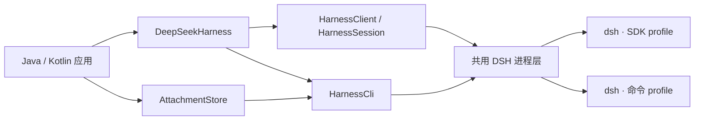

# SDK 使用与架构

[English](sdk.md) | **中文**

## 边界与依赖

`libs/dshjk` 是 JVM SDK，供 Kotlin 和 Java 应用使用。`libs/dshjk-spring-boot-starter` 提供可选的 Spring 集成。添加依赖见 [README](../README.zh.md#添加依赖)，Spring 配置与工具接入见 [Spring 集成文档](spring.zh.md)。



`configuration` 定义启动参数，`runtime/internal` 管理进程启动、终止和临时文件。`client/internal` 处理 stdio JSON-RPC、请求关联、回调与事件分发。`DeepSeekHarness` 负责初始化和关闭，`HarnessSession` 收集每次输入触发的活动。Java 的阻塞方法委托给 Kotlin 的挂起方法。

一个 Harness 的 Agent 会话共用一个 SDK profile 子进程。运行时拥有 Agent loop、Session history、模型路由、工具、审批策略、工作目录、goal/plan 状态及持久化；SDK 仅保存初始化状态、RPC 等待项、Session 句柄和通知订阅。`DeepSeekHarness()` 可直接使用默认配置。`session()` 是惰性句柄，自动生成官方 SDK 格式的 `session-<32 位十六进制 UUID>`；相同句柄上的多次输入继续同一会话。`run(input)` 每次创建新会话，显式 `session(id)` 则使用调用者提供的 ID。SDK 协议要求请求携带 ID，自动生成逻辑集中在创建句柄时，与官方客户端一致。

## 完整 SDK 操作

| 原生请求 | Java/Kotlin 同一 API | 返回/语义 |
| --- | --- | --- |
| `initialize` | `HarnessClient.initialize` | `InitializeResult`，校验 server identity |
| `session/prompt` | `prompt` | `PromptReceipt`，直接入队，绕过命令路由 |
| `session/query` | `query` | `QueryResult.Prompt` 或 `QueryResult.Command` |
| `session/resume` | `resumeSession` | 恢复已持久化会话，无新输入 |
| `session/wait` | `waitForSession` | 等待已拥有会话及其受管理后代 |
| `session/working-directory/get` | `getWorkingDirectory` | 当前有效绝对目录 |
| `session/working-directory/set` | `setWorkingDirectory` | 改变当前目录，返回有效目录 |
| `shutdown` | `shutdown` | 协议关闭；`close` 还会回收进程 |

低层请求前须初始化。高层 `DeepSeekHarness.start()` 在首次调用时自动完成初始化，并发调用共享一次握手；失败时关闭进程并将实例置为终态，修正配置后创建新实例。关闭可以打断仍在等待的握手。库不会自动重试已发出的输入。

`HarnessClient.request(SdkRequestMethod, ...)` 提供内置方法名的类型化入口；字符串重载可调用 profile 新增的方法，使用 `JsonObject` / `JsonElement` 保留扩展载荷。`RpcException` 保留远端 `code`、message、data；`ProtocolException` 表示收到的已知字段不符合协议；`RequestTimeoutException` 表示本地等待超时；`TransportClosedException` 带 profile、进程状态及最多 64 KiB stderr 尾部。

## 输入、回执与完成

`session.run(text)` 或 `session.run(List<ContentBlock>)` 将输入交给原生 `session/query`，不在 JVM 重写命令语法。文本、reasoning、编码图片、持久化图片/文件引用、tool-call、tool-addition、tool-removal 均有类型；插件新增块可用 `ContentBlock.Extension`。图片使用 base64 和受支持的 MIME，实际内容校验与持久化由运行时完成，模型必须支持图片。

```kotlin
val input = listOf(
    ContentBlock.Text("分析这张图"),
    ContentBlock.EncodedImage(base64, ImageMediaType.IMAGE_PNG, "screenshot.png"),
)
val result = session.run(input)
```

普通输入的 `messageId` 只是持久化入队回执。`run` 在发请求前订阅，忽略该 message 的 `agent/inbox/spliced` 之前的通知，之后持续收到根 Session 与已知后代通知，直到根 Agent `idle`。结果中 `events` 只含根 Session，子 Agent 的文本不会覆盖根回复。`finalResponse` 是最后一条根 assistant message 中 text 的拼接；`finishReason` 使用 `FinishReason` 表达最后一条 `turn/end.reason.kind`，例如 `FinishReason.Builtin.COMPLETED`。

原生命令按 `commandId` 关联 `command/run`、`command/done` 与 `session.query.completed`。`run` 等待命令活动结束而非单独等待 idle，因而适用于无模型活动的 `/permission`、`/compact`，以及可启动后续活动的 `/plan`、`/goal`。缺失配对生命周期事件会抛协议错误；原生命令拒绝通过结果返回。具体命令是否可用由 profile 决定。

多个 Session 或同 Session 的输入可以重叠；每次调用持有独立订阅，不会竞争消费同一队列。普通输入的活动区间可能包含同 Session 的重叠工作，与官方 SDK 一致。observer 按接收顺序同步执行；其异常结束本次收集并释放订阅，不撤销已提交给运行时的工作。

需要逐条处理事件并返回最终结果时，Kotlin 和 Java 都可以使用 `runStreaming(input, observer)`。它返回 `RunSummary`，包含 Session ID、最终文本和结束原因。需要在运行结束后访问本次事件和通知时，使用返回 `RunResult` 的 `run()`。

## 事件订阅

原生 SDK 推送已记录的 `session.event` 和状态通知，assistant 文本随每个模型步骤结算后的 `assistant/message` 到达。`AssistantMessage.stream` 是该次模型尝试的历史分块记录，不能据此宣称接收到了生成过程中的实时 token delta。消费方应在事件到达时输出该条消息的文本，并同时处理工具调用、工具结果和状态变化。

可运行的 [Kotlin Flow 示例](../examples/kotlin/src/main/kotlin/example/KotlinExample.kt) 和 [Java JDK Publisher 示例](../examples/java/src/main/java/example/JavaExample.java) 都先创建独立订阅，再开始 `runStreaming()`。主 Session 文本输出到 stdout，工具、命令、子 Agent、状态和结束原因输出到 stderr。命令有文本结果时也写入 stdout。输入结束后关闭运行时，等待已收到的事件排空，再释放订阅；正常关闭导致的 `TransportClosedException` 在示例中作为结束信号，其他订阅错误继续向调用者传播。结果文本已由事件处理器输出，因此不会再次打印 `finalResponse`。

六个已知 SDK 通知都有独立类型：`Event`、`Status`、`QueryCompleted`、`SubagentStarted`、`SubagentFinished`、`QuestionCancelled`。`method` 使用 `NotificationMethod`；内置方法是 `NotificationMethod.Builtin` 枚举，新增通知使用 `Extension`，所有通知保留原始 params。

`SessionEvent.type` 使用 `SessionEventType`，当前基线的 63 个内置名称集中定义在 `SessionEventType.Builtin`；`data` 使用 sealed 接口 `SessionEventData`，每个内置事件对应具体数据类。turn/step、消息与流、工具调用、命令、审批、compaction、goal、todo、job、team 等都可直接读取类型化字段。`seq`、`time` 是经过校验的整数；完整原生 envelope（含 surface metadata 和未知字段）仍保留在 `raw` 中。

固定状态使用枚举，例如 `AgentStatus`、`RunStatus`、`CommandStatus`、`TodoStatus`、`JobStatus`、`GoalPhase`、`ImageMediaType`。`TurnEndReason` 和 `QuestionIntent` 使用带载荷的 sealed 类型，例如 `TurnEndReason.Aborted` 携带 `AbortReason`，`TurnEndReason.Error` 携带 `LlmFailure`，`QuestionIntent.PlanReview` 携带批准选项与调用标识。图片和文件引用分别使用 `ImageAttachment`、`FileAttachment`。

原生允许扩展的事件名称、通知方法、结束原因与内容块类型采用“内置枚举 + Extension”的开放类型。未知值保留原始名称和 JSON；已知类型缺字段或状态值非法时抛 `ProtocolException`，不会降级成扩展类型。可用 `.wireName` 获取精确协议拼写。工具参数、JSON Schema、provider replay state 和插件自有消息来源等原本开放的元数据继续使用 JSON。

Kotlin 可直接按载荷类型分支：

```kotlin
when (val data = event.data) {
    is SessionEventData.ToolCalled -> println(data.name)
    is SessionEventData.TurnEnded -> println(data.reason.kind.wireName)
    is SessionEventData.TodosWritten -> data.todos.forEach { println(it.status) }
    else -> Unit
}
```

Java 17 可用 `event.getData() instanceof SessionEventData.ToolCalled call`，然后读取 `call.getName()`；固定状态直接与枚举值比较。插件事件可通过 `SessionEventData.Extension` 读取原始值，或用 `decodeData(serializer)` 解码成插件自有类型。SDK 不重建或迁移原生会话日志。

订阅创建时即注册，每个订阅有独立缓冲，默认 8192 条；溢出仅使该订阅抛 `SlowConsumerException`，不堵塞协议读取。进程结束时先允许消费已收到的通知，再抛终态错误；显式关闭订阅丢弃队列。`next(Duration)` 的超时只影响一次等待，订阅仍可继续消费。

Kotlin：

```kotlin
val subscription = harness.client.subscribe(session.id) // 根会话及已发现后代
try {
    subscription.events.collect { notification -> /* 更新 UI */ }
} finally {
    subscription.close()
}
```

生产应用应在另一个协程启动输入，持续消费订阅。高层 `run` 的逐条反馈也可直接传 `NotificationObserver`。

Java：先创建 `NotificationSubscription`，再调用 `subscription.events().subscribe(Flow.Subscriber)`，按 JDK Publisher 的 demand 协议消费；`next()` 则是阻塞入口。一个订阅对应一个消费者；需要多个消费者时创建多个订阅。取消 Publisher 订阅会取消其等待，拥有者仍应关闭 `NotificationSubscription`。

Session tree 依据 `subagent.started` 维护，包含创建前已发现的后代，按生命周期清理整个进程的关系表。远程 Agent 没有上游通知时，SDK 不推断其生命周期。

## 审批与用户问题

构造配置时安装回调；高层初始化自动声明对应 capability，直接使用低层 initialize 时由调用者显式声明。未安装时不抢占原生 answerer chain。SDK 不默认选择答案。

```kotlin
val config = HarnessConfig(
    dshHome = home,
    approvalHandler = ApprovalHandler { request, cancellation ->
        // 在业务 UI 中展示 request.toolName / reason；仅显式允许时返回 ALLOWED_ONCE
        ApprovalResult(ApprovalOutcome.REJECTED)
    },
    userQuestionHandler = UserQuestionHandler { request, cancellation ->
        UserQuestionResult.Answer(listOf(AnswerItem(request.questions.single().id, listOf("CSV"))))
    },
)
```

Java 使用 builder 的同名方法和相同 SAM 接口。`approval/request` 返回 `ALLOWED_ONCE`、`REJECTED`、`CANCELLED`，一次允许不持久化授权。`user-question/ask` 返回 `Answer` 或 `UserQuestionResult.Cancelled`（Java 使用 `INSTANCE`）；每个原问题 id 必须且只能回答一次。取消不代表批准。

回调在独立 IO 工作线程运行，可以嵌套请求 SDK；协议读取线程不会等待 UI。回调可并发。收到 `user-question.cancelled` 或连接关闭时，`CancellationToken.isCancelled` 置位并中断回调线程；宿主应及时释放自己的 UI/等待资源。回调异常返回 RPC error，取消后的答案不会用于后续运行。忽略中断的宿主代码可能继续执行，SDK 不等待这类代码无限期退出。

## 配置与资源生命周期

| 配置 | 默认值/用途 |
| --- | --- |
| `dshHome` | 可选；省略时由原生运行时按 `DSH_HOME` → `~/.dsh` 发现，显式值优先 |
| `runtime` | 显式命令优先；省略时查找[随包运行时](../README.zh.md#随应用交付-dsh)，然后使用 PATH 上的 `dsh` |
| `profile` | `sdk`，原生运行时组合 |
| `patches` / `patchFiles` | 空 / 空；内联数据类操作与随后应用的原始 patch 文件 |
| `cwd` / `processCwd` | JVM 当前目录 / cwd；分别表示 Agent workspace 与子进程目录 |
| `environment` / `inheritEnvironment` | 空 / true；覆盖继承环境，false 表示完整替换；仅显式设置 `dshHome` 时覆盖子进程的 `DSH_HOME` |
| `provider` / `model` | `deepseek-official` / `deepseek-v4-flash` |
| `reasoningEffort` / `maxTokens` | 留空，使用适配器默认；配置时必须非空/正整数 |
| `initializeTimeout` | 30 秒，等待首次 profile 握手 |
| `requestTimeout` | 默认无界。配置后限制等待发送和接收 RPC 应答的时间，后续 Agent 活动有独立生命周期 |
| `shutdownTimeout` / `eofGrace` / `terminateGrace` | 1 / 6 / 3 秒 |
| `notificationBufferCapacity` | 8192，每个订阅独立 |

超时统一使用 `java.time.Duration`。Kotlin 可写 `HarnessConfig(requestTimeout = Duration.ofSeconds(45))`，Java 可写 `HarnessConfig.builder().requestTimeout(Duration.ofSeconds(45)).build()`。

配置通过可省略的 `HarnessConfig()` 或 Java `HarnessConfig.builder()` 创建，集合在边界复制为不可修改值，内联 patch 的 JSON 在构造配置时形成快照。省略 `dshHome` 时，SDK 保留子进程环境，由运行时解析 home，包括空白环境值回退和 `~` 展开；SDK 不在 JVM 内复制发现算法。启动参数按 argv 传递，不经 shell 解释；`RuntimeCommand.of` 支持显式 launcher 前缀，例如自定义 Node loader。SDK 不修改宿主全局环境。

Kotlin 的 `closeAsync()` 和 Java 的 `close()` 使用同一关闭实现。关闭 harness 会取消正在执行的 CLI 和附件调用。RPC 客户端停止宿主回调，在时限内尝试发送 `shutdown` 并等待 stdin EOF 清理。进程层终止仍在运行的进程，包括终止时可见的后代，并确认退出。插件负责释放自己创建的资源。关闭幂等且不可重启，Kotlin 的关闭在 `NonCancellable` 中执行。

本地请求超时或协程取消会撤回尚未开始的发送，移除等待项并忽略迟到响应。已开始写入的请求仍可能由运行时执行。要中止整个运行时须关闭其拥有者。SDK 不加入无依据的 Session abort 方法。

`resumeSession(id)` 必须使用原来的 home；找不到、占用或不兼容的历史由原生报错，不创建替代会话。恢复不等于恢复旧 shell/browser 进程。`get/setWorkingDirectory` 可惰性创建 Session，相对目录由该 Session 当前目录解析，设置不改变原始目录元数据、权限或已有外部进程。

## 数据类 patch 与供应商配置

`HarnessPatch` 表示一条原生 Cordis 操作：`id + config` 替换已有条目的完整配置，`id + disabled` 切换状态，`insert` 插入 `HarnessPlugin`；带 `id` 的插入以该条目作为目标 group。`name` 是已有条目的名称匹配条件。插件配置使用 JSON 值的 Map，插件扩展仍可定义自己的字段。

供应商有类型化的 `LlmProviderConfig`、`LlmModelConfig` 和 `LlmApi`，不需要手写 YAML 或临时文件：

```kotlin
val config = HarnessConfig(
    provider = "gateway",
    model = "my-model",
    environment = mapOf("GATEWAY_API_KEY" to requireNotNull(System.getenv("GATEWAY_API_KEY"))),
    patches = listOf(HarnessPatch.providers(mapOf(
        "gateway" to LlmProviderConfig(
            api = LlmApi.OPENAI_COMPLETIONS,
            baseUrl = URI.create("https://gateway.example/v1"),
            apiKeyEnv = "GATEWAY_API_KEY",
            models = listOf(LlmModelConfig("my-model", contextWindow = 131072, maxTokens = 8192)),
        ),
    ))),
)
```

容量与模型 ID 按供应商实际值填写。`apiKeyEnv` 引用子进程环境或原生凭据存储中的键；密钥值不放入 provider patch。协议枚举还支持 `OPENAI_RESPONSES` 与 `ANTHROPIC_MESSAGES`。默认 `sdk` 已有 `llm-pi-ai` 条目；`sdk-minimal` 需要 `HarnessPatch.providers(..., insertAdapter = true)` 插入适配器。自定义 profile 需按自身组合选择覆盖或插入。

MCP 使用同一入口，连接由原生客户端管理：

```kotlin
val patch = HarnessPatch.mcpServers(mapOf(
    "external" to McpServerConfig(URI.create("http://127.0.0.1:8080/mcp")),
))
val config = HarnessConfig(patches = listOf(patch))
```

其他插件可以直接使用数据类：

```kotlin
HarnessPatch(id = "terminal-bash", disabled = true)
HarnessPatch(insert = listOf(HarnessPlugin(
    id = "my-plugin",
    name = "@example/dsh-plugin",
    config = mapOf("enabled" to true, "limit" to 10),
)))
```

Java 使用相同数据类构造器、`HarnessPatch.providers(...)` / `mcpServers(...)` 和 builder 的 `patches(...)`。

已有 YAML/JSON 文件使用 `HarnessConfig(patchFiles = listOf(Path.of("tools.patch.yml")))` 或 `builder.patchFiles(...)`。SDK 首次启动子进程时才把全部内联操作写入一个私有临时目录中的 JSON 文件，之后依次传递 `patchFiles`，所以原始文件可覆盖内联配置。启动失败会清理生成文件；正常关闭、初始化失败或异常退出后的 `close()` 在确认子进程退出后清理它们。用户文件由调用者维护。每个客户端独立拥有生成文件，创建配置或 Spring 容器不会创建这些文件。

持久化工具与 MCP 配置归 profile；调用级 patch 在本客户端下次启动时生效。配置覆盖采用原生的完整替换规则，覆盖 `llm-pi-ai` 时要提供希望保留的全部 providers。

## DSH 命令与附件

`harness.cli.execute(ProfileInvocation(...))` 执行指定的 DSH profile。RPC 与 CLI 共用可执行文件、`processCwd`、环境变量及 `DSH_HOME` 配置。DSH 根据 profile、home 和启动时的 patch 装配插件。CLI 调用各自指定内联 patch 和 patch 文件，按此顺序应用。应用参数通过 `--` 交给 profile。

```kotlin
import com.elonzh.dshjk.configuration.ProfileInvocation

val result = harness.cli.execute(ProfileInvocation("headless", listOf("--help")))
check(result.exitCode == 0) { result.stderr }
println(result.stdout)
```

`execute` 默认提供空 stdin，也可传入 `input: Path`。默认以 UTF-8 捕获 stdout 和 stderr，各限 1 MiB。传入 `output: Path` 时 stdout 直接写到该文件，结果中的 `stdout` 为 `null`，命令失败时文件可能保留部分输出。正常退出返回 `CliResult`，包括非零退出码。启动或捕获输出失败抛出 `CliException`，超时抛出 `RequestTimeoutException`，命令默认超时为 30 秒。

命令每次启动独立进程，可在 SDK 会话启动前调用。

应用可以在 DSH profile 中安装插件，也可以用 `ProfileInvocation.patches` 在本次启动时挂载插件。命令插件通过 `ctx.cmdlineArgs` 获取参数，在 `ctx.appReady` 后执行，并用 `ctx.appExit` 退出。[DSH 命令行插件指南](https://github.com/deepseek-ai/deepseek-harness/blob/master/docs/user/develop/basic/publish.md#give-a-surface-bundle-its-own-command-line)

### 存取附件

使用 `sdk` 或 `sdk-minimal` 时，按需创建 `AttachmentStore(harness)`。附件命令在独立进程中复用 SDK profile 及其 patch，通过该 profile 的 `attachments` 服务存取附件。自定义命令 profile 只需提供此服务，即可用 `AttachmentStore(harness.cli, invocation)` 接入。该调用的应用参数应为空，由附件适配器提供命令参数并占用标准输入输出。若修改了磁盘上的存储配置，请重建 harness，使会话和新启动的附件命令使用同一份配置。

```kotlin
import com.elonzh.dshjk.attachment.AttachmentStore

val config = HarnessConfig(dshHome = Path.of("/data/dsh"), profile = "sdk-minimal")
DeepSeekHarness(config).use { harness ->
    val attachments = AttachmentStore(harness)
    val image = attachments.saveImage(Path.of("screenshot.png"), ImageMediaType.IMAGE_PNG)
    val file = attachments.saveFile(Path.of("data.csv"))
    harness.run(listOf(ContentBlock.Text("分析这些附件"), ContentBlock.Image(image), ContentBlock.File(file)))
    attachments.readFile(file, Path.of("download.csv"))
}
```

保存返回 DSH 原生附件引用。DSH 校验并标准化图片，普通文件保留原始字节。读取校验成功后才替换目标文件。`AttachmentException.code` 提供原生错误码，可区分 `INVALID_IMAGE`、`ATTACHMENT_NOT_FOUND` 和 `ATTACHMENT_CORRUPT` 等错误。普通文件在模型输入中以引用表示，读取其内容需要相应的工具。宿主应用负责授权、配额和保留期限。

上传内容已经是流时，可调用 `saveFile(InputStream, name)` 或 `saveImage(InputStream, mediaType[, name])`，无需先写成本地文件。SDK 从流的当前位置分块写入 DSH 的 stdin；DSH 对图片按配置限制读取并标准化。已有本地文件时，可继续使用 `Path` 重载。

例如，Java 的 multipart 处理器可直接传入上传部分的流：

```java
try (var input = part.getInputStream()) {
    return attachments.saveFile(input, part.getSubmittedFileName());
}
```

流由调用方关闭，Kotlin 可用 `use { ... }`。附件命令的默认超时为 30 秒；取消会停止 DSH 进程，但阻塞中的 `InputStream.read` 能否立即返回取决于具体实现。为网络输入配置读取超时，以便调用及时结束。

### 读取图片流

`openImage(ImageAttachment)` 返回经过校验的标准化图片流。HTTP 处理器可以用引用中的媒体类型和字节数设置响应头，关闭流时会删除临时文件。

```java
try (var stream = attachments.openImage(image)) {
    response.setContentType(image.getMediaType().getWireName());
    response.setContentLengthLong(image.getBytes());
    stream.transferTo(response.getOutputStream());
}
```

Kotlin 调用挂起的 `openImage`，并用 `use { ... }` 关闭流。

### 按附件 ID 下载文件

保存成功后，将 `FileAttachment` 与应用中授予访问权限的记录一并持久化。DSH 读取时需要包含 ID、文件名和字节数的引用。同一份字节以不同文件名保存时可能共享 ID，因此查找应限定在当前请求有权访问的范围内。[DSH 附件服务接口](https://github.com/deepseek-ai/deepseek-harness/blob/fcc0ad4621/packages/attachment/attachment/src/index.ts)

Java 下载处理器可以调用阻塞方法。示例中的 `fileLookup` 根据当前请求查找有权访问的引用，找不到时返回 `null`。在写出响应之前捕获 `ATTACHMENT_NOT_FOUND` 并映射到 404。

```java
try (var stream = attachments.openFile(attachmentId, fileLookup)) {
    response.setContentType("application/octet-stream");
    response.setContentLengthLong(stream.getAttachment().getBytes());
    stream.transferTo(response.getOutputStream());
}
```

已有引用时可直接调用 `openFile(FileAttachment)`。两个重载都在 DSH 校验并写入临时文件后返回流，关闭流会删除临时文件。这样可以在发送响应头之前处理校验失败，下载也无需把整个文件载入内存。Kotlin 调用对应的挂起方法，并用 `use { ... }` 关闭流。

## 兼容与验证边界

协议基线：上游 checkout `fcc0ad4621`，公开 npm CLI `@deepseek-ai/dsh@0.2.2-rc.1`。权威协议是上游 `packages/sdk/protocol/src/types.ts`；SDK 高层活动算法对齐该版本 TS/Python SDK。库不强制所有未来运行时与基线版本相等，但只宣称对基线完成验证。

本地验证覆盖 JDK 17/21、Java/Kotlin 消费、双向 RPC、Unicode、命令关联、并发 Session、独立订阅与溢出、回调嵌套请求、取消与超时、stderr、握手失败/异常退出/强制回收。未经修改的真实 CLI 配合本地 Messages HTTP 夹具，覆盖 sdk-minimal 的模型请求/并发/自动 Session ID 与恢复/工作目录/home 默认发现与配置优先级，以及完整 sdk 的 permission/compact/max-tokens/用户问题。SDK 构建 CI 在 Linux 上使用 JDK 17 和 21；独立的运行时打包流程覆盖 Linux、macOS 和 Windows。本机执行只代表 macOS，真实云模型、Windows/Linux 平台、图片入库与具体外部工具仍需相应环境验证。Spring 集成的真实 MCP 与 OpenAI 兼容端点验证见 [Spring 文档](spring.zh.md)。
