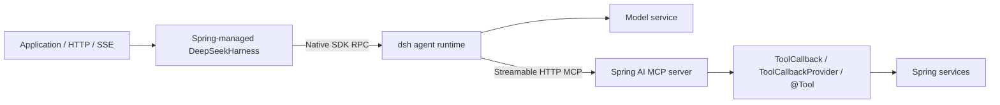

# Spring Boot 4 and Spring AI

**English** | [中文](spring.zh.md)

## Responsibilities and dependencies

`com.elonzh:dshjk-spring-boot-starter` is an optional integration that depends on the core `dshjk` SDK and Spring Boot. The core SDK has no Spring dependency. The integration baseline is Spring Boot **4.1.2**, Spring AI **2.0.2**, and JDK 17+. The starter's auto-configuration is also tested against Spring Boot **4.0.9**.

The starter and Spring example are written in Kotlin. Java applications can use the same artifact. Spring manages configuration, Java and Kotlin services, tool implementations, and the client lifecycle. Harness manages sessions, history, model routing, the agent loop, tool selection, approvals, and persistence. The official Spring AI Streamable HTTP MCP server exposes tools to the native Harness MCP client.



## Add the starter

Use the same version as the SDK.

```kotlin
implementation("com.elonzh:dshjk-spring-boot-starter:0.1.0")
```

Inject the client into your Spring Boot application:

```kotlin
@Service
class AssistantService(private val harness: DeepSeekHarness) {
    suspend fun ask(input: String): RunResult = harness.run(input)
}
```

The starter registers its auto-configuration through Boot's `AutoConfiguration.imports` and provides `HarnessConfig` and `DeepSeekHarness` beans by default. The first SDK operation starts the CLI. When the application context shuts down, it calls the SDK's `close()`, which waits for the runtime to exit before removing generated connection files.

Home discovery, session IDs, model routing, and other omitted settings follow the [SDK defaults](sdk.md#configuration-and-lifecycle). Use `DeepSeekHarness` as a process-wide singleton. Use `harness.run(input)` for independent requests, and keep a session handle or the returned session ID for a conversation that spans requests.

### Configuration

```yaml
dshjk:
  cwd: /path/to/workspace
  # All settings are optional; omitted values follow the core SDK defaults.
  # dsh-home: /path/to/isolated-home
  # runtime:
  #   cli: /path/to/@deepseek-ai/dsh/lib/bin.js
  #   node: node
  # profile: sdk
  # provider: deepseek-official
  # model: deepseek-v4-flash
  # request-timeout: 2m
```

| Setting | Purpose |
| --- | --- |
| `dshjk.enabled` | Defaults to true; set false to disable auto-configuration |
| `dshjk.dsh-home` | Optional home override; dsh discovers its home when omitted |
| `dshjk.cwd` / `process-cwd` | Agent workspace / runtime process working directory |
| `dshjk.runtime.executable` | Custom executable; mutually exclusive with `cli` |
| `dshjk.runtime.cli` / `runtime.node` | JavaScript CLI module and optional Node executable; `node` requires `cli` |
| `dshjk.profile` | Native profile |
| `dshjk.patches` / `patch-files` | Inline typed operations / raw patch files applied afterward |
| `dshjk.providers` | Typed native provider configuration |
| `dshjk.spring-ai.enabled` | Defaults to true; enables connection discovery from existing ChatModel beans |
| `dshjk.provider` / `model` / `reasoning-effort` / `max-tokens` | Initial model routing, reasoning effort, and output token limit |
| `dshjk.environment` / `inherit-environment` | Child process environment and whether to inherit the parent environment |
| `dshjk.initialize-timeout` / `request-timeout` | Time limits for the handshake and RPC responses |
| `dshjk.shutdown-timeout` / `eof-grace` / `terminate-grace` | Time limits for runtime shutdown stages |
| `dshjk.notification-buffer-capacity` | Buffer size per notification subscription |

`HarnessProperties` is an immutable Kotlin data class bound through its constructor. Kapt and the official Boot configuration processor generate its configuration metadata. Bean creation produces an immutable `HarnessConfig`. To apply startup configuration changes, create a new client or restart the application.

### Providers and inline patches

Put existing provider settings directly in `application.yml`:

```yaml
dshjk:
  provider: gateway
  model: my-model
  providers:
    gateway:
      api: openai-completions
      base-url: https://gateway.example/v1
      api-key-env: GATEWAY_API_KEY
      models:
        - id: my-model
          context-window: 131072
          max-tokens: 8192
  environment:
    GATEWAY_API_KEY: ${GATEWAY_API_KEY}
  patches:
    - id: terminal-bash
      disabled: true
  # patch-files:
  #   - /absolute/path/last.patch.yml
```

`providers` binds to the core SDK's `LlmProviderConfig` and `LlmModelConfig`, with `LlmApi` for the protocol. `patches` binds to `HarnessPatch` and supports `id`, `config`, `disabled`, `name`, and `insert`. Inserted entries use `HarnessPlugin`. A plugin's `config` accepts a map of JSON values. Providers and MCP connections have dedicated types. See [typed patches and provider configuration](sdk.md#typed-patches-and-provider-configuration) for examples and override rules.

Auto-configuration orders the provider patch first, then the MCP patch, then the application's inline `patches`. The core SDK writes them to one startup file on demand, and the runtime applies raw `patch-files` after that file. A customizer can replace either collection before startup. The default `sdk` profile overrides the existing adapter; `sdk-minimal` inserts the multi-provider adapter. A custom profile must supply the appropriate entry.

### Discover model settings from Spring AI ChatModel

If your application already has a Spring AI **2.0.2** `OpenAiChatModel` or `AnthropicChatModel` bean, the starter tries to reuse its model, API endpoint, static API key, request headers, and output token limit. Spring AI and its provider modules are optional application dependencies. The starter does not install or create a ChatModel.

For example, an application with the Spring AI OpenAI starter might have:

```yaml
spring:
  ai:
    openai:
      api-key: ${OPENAI_API_KEY}
      base-url: https://api.openai.com/v1
      chat:
        model: gpt-4o-mini
        max-completion-tokens: 1024
```

For models that Spring AI configures automatically, the starter reuses the connection settings resolved by the factory. For manually built models, it looks for both the API endpoint and the key in the public options. Supply a custom extractor with the full connection settings to reuse a connection from a custom HTTP client. Native dsh still runs the model requests and agent loop.

- Custom `HarnessConfig` or `DeepSeekHarness` beans take over configuration.
- An explicit `dshjk.provider`, `model`, `providers`, inline patch targeting a built-in model plugin, or `environment.DEEPSEEK_API_KEY` or `DEEPSEEK_BASE_URL` takes precedence over discovery.
- Inline tool patches and raw `patch-files` can be combined with model discovery and are applied in native order. If a raw file configures model routing, also set `dshjk.provider` and `model`, or disable discovery with `dshjk.spring-ai.enabled: false`.
- If several ChatModel beans exist, use `@Primary` to select one. If there is no unique candidate or the connection cannot be extracted, the starter uses the native defaults.
- Customizers run after model discovery and property conversion.

The starter snapshots the extracted settings when it creates the configuration. It passes the API key to dsh in a dedicated `DSH_SPRING_AI_API_KEY_*` environment variable, which native tool subprocesses filter out. The generated provider patch stores the variable name. Use explicit connection settings or a custom extractor to handle OAuth, proxies, and authentication headers.

Register an ordered `SpringAiModelConfigurationExtractor` for other ChatModel implementations:

```kotlin
@Bean
@Order(0)
fun customModelExtractor(): SpringAiModelConfigurationExtractor =
    SpringAiModelConfigurationExtractor { model ->
        if (model is MyChatModel) {
            SpringAiModelConfiguration(
                provider = "company",
                model = model.modelId,
                connection = LlmProviderConfig(
                    api = LlmApi.OPENAI_COMPLETIONS,
                    baseUrl = model.endpoint,
                    models = listOf(LlmModelConfig(model.modelId, 131072, 8192)),
                ),
                apiKey = model.apiKey,
            )
        } else null
    }
```

Return null when the extractor does not support that model instance. The core SDK receives a regular `HarnessConfig` and has no Spring AI dependency.

### Application overrides and callbacks

Provide a custom `HarnessConfig` bean to replace the generated config. Provide a custom `DeepSeekHarness` bean to take over both configuration and lifecycle.

Auto-configuration wires `ApprovalHandler` and `UserQuestionHandler` beans and declares the corresponding native capabilities on initialization. For example:

```kotlin
@Bean
fun approvals(): ApprovalHandler = ApprovalHandler { _, _ ->
    ApprovalResult(ApprovalOutcome.REJECTED)
}
```

The application is responsible for presenting the request and returning the user's decision. Callbacks run on worker threads and may overlap. Use `CancellationToken` to respond to runtime cancellation.

For finer control, provide an ordered `HarnessConfigCustomizer`. It runs after property and callback binding:

```kotlin
@Bean
fun runtimeCustomization(): HarnessConfigCustomizer = HarnessConfigCustomizer { builder ->
    builder.maxTokens(8192)
}
```

The customizer uses the core SDK builder, so setting a collection replaces the corresponding collection. It can also set native callbacks and an explicit launcher prefix. A custom `HarnessConfig` bean bypasses the default property conversion, callback discovery, and customizers.

## Connect Spring AI tools

Add the official Spring AI MCP server starter to your application and use the BOM to manage its version:

```kotlin
implementation(platform("org.springframework.ai:spring-ai-bom:2.0.2"))
implementation("org.springframework.ai:spring-ai-starter-mcp-server-webmvc")
```

Define a tool and register a `ToolCallbackProvider`:

```kotlin
class CalculatorTools {
    @Tool(name = "add", description = "Add two integers")
    fun add(left: Int, right: Int): Int = Math.addExact(left, right)
}

@Configuration(proxyBeanMethods = false)
class ToolsConfiguration {
    @Bean
    fun calculatorTools(): CalculatorTools = CalculatorTools()

    @Bean
    fun calculatorCallbacks(calculator: CalculatorTools): ToolCallbackProvider =
        MethodToolCallbackProvider.builder().toolObjects(calculator).build()
}
```

Keep tool parameter names with `kotlin { compilerOptions.javaParameters.set(true) }` for Kotlin or `-parameters` for Java. See [CalculatorToolsConfiguration](../examples/spring-boot/src/main/kotlin/example/spring/CalculatorToolsConfiguration.kt) for the full registration. You can also register individual `ToolCallback` beans; the official MCP auto-configuration exposes them as tools.

```yaml
server:
  address: 127.0.0.1
  port: 8080
spring:
  ai:
    mcp:
      server:
        name: application-tools
        version: 0.1.0
        type: SYNC
        protocol: STREAMABLE
dshjk:
  mcp:
    application:
      url: http://127.0.0.1:${server.port}/mcp
```

`dshjk.mcp` is a connection map keyed by server name. Names follow the native pattern `[A-Za-z0-9_-]{1,32}`; the model sees tool names such as `mcp__application__add`. Each connection supports:

| Setting | Purpose |
| --- | --- |
| `url` | Required absolute HTTP(S) MCP endpoint |
| `headers` | Optional map of HTTP headers for authentication and request context |
| `startup-timeout` | Optional native connection startup timeout |
| `tool-call-timeout` | Optional native tool call timeout |

The starter converts connections to `HarnessPatch.mcpServers(...)` entries with IDs of the form `dshjk-mcp-<server name>` and places them before the application's inline `dshjk.patches`. The core SDK generates the patch file on first runtime launch and removes it after the client closes. The caller owns any user-supplied files. The native Harness MCP plugin manages connections, tool synchronization, timeouts, and reconnection.

To host tools in another Spring Boot service, point the URL at that service. The MCP service handles authentication and request context; JVM objects and thread context do not cross the process boundary automatically. If you set `server.port=0`, supply the actual MCP URL to the client once the port is known. The example uses a fixed port, and the integration tests use a separate tool service that is already running.

## Run the full example

Make `dsh` available (see [bundle dsh with your application](../README.md#bundle-dsh-with-your-application)), configure model credentials, and run:

```sh
./gradlew :examples:spring-boot:run
```

The web and MCP services start without making a model call. The first `/run` request starts Harness with the existing native home and credentials.

```sh
curl -H 'Content-Type: application/json' \
  -d '{"text":"Use the add tool to calculate 20 plus 22."}' \
  http://127.0.0.1:8080/run

curl -N -H 'Content-Type: application/json' \
  -d '{"text":"Use the add tool to calculate 20 plus 22."}' \
  http://127.0.0.1:8080/run/events
```

`/run` returns the session ID, final text, and finish reason. `/run/events` sends native notifications individually and ends with a `result` event. Both use `runStreaming()`, so the SDK keeps only the final summary. See [event subscriptions](sdk.md#event-subscriptions) for when notifications arrive. The SDK waits on a task executor managed by Boot. If a client disconnect causes a send to fail, the request stops collecting events; work already started in dsh follows the native lifecycle.

## Verification

Follow the [development instructions](../README.md#development) to run integration tests with Spring AI and MCP. They use a local model endpoint and do not need model credentials.

To test the starter against the earlier Spring Boot 4.0 baseline:

```sh
./gradlew :dshjk-spring-boot-starter:test -PspringBootVersion=4.0.9
```

References: [Spring Boot custom auto-configuration](https://docs.spring.io/spring-boot/reference/features/developing-auto-configuration.html) and [Spring AI Streamable HTTP MCP server](https://github.com/spring-projects/spring-ai/blob/v2.0.2/spring-ai-docs/src/main/antora/modules/ROOT/pages/api/mcp/mcp-streamable-http-server-boot-starter-docs.adoc).
