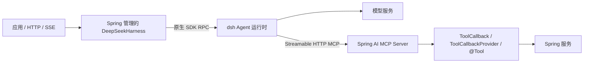

# Spring Boot 4 与 Spring AI

[English](spring.md) | **中文**

## 职责与依赖

`com.elonzh:dshjk-spring-boot-starter` 是可选框架集成，依赖核心 `dshjk` 和 Spring Boot。核心 SDK 的依赖中没有 Spring。当前集成基线为 Spring Boot **4.1.2**、Spring AI **2.0.2** 和 JDK 17+；starter 的自动配置另外通过 Spring Boot **4.0.9** 回归。

starter 和 Spring 示例均使用 Kotlin 实现，Java 应用可以直接消费同一制品。Spring 管理配置、Java/Kotlin 服务、工具实现和客户端生命周期；Harness 管理 Session、历史、模型路由、Agent 循环、工具选择、审批及持久化。Spring AI 工具使用官方 Streamable HTTP MCP Server，Harness 通过其原生 MCP client 调用这些工具。



## 使用 starter

Starter 与 SDK 使用相同的版本。

```kotlin
implementation("com.elonzh:dshjk-spring-boot-starter:0.2.2")
```

在已有 Spring Boot 应用中注入客户端：

```kotlin
@Service
class AssistantService(private val harness: DeepSeekHarness) {
    suspend fun ask(input: String): RunResult = harness.run(input)
}
```

自动配置通过 Boot 的 `AutoConfiguration.imports` 注册。默认创建 `HarnessConfig` 和 `DeepSeekHarness`，不在 Spring 容器启动时启动 CLI。首次 SDK 操作才会启动运行时；容器关闭时调用同一 SDK 的 `close()`，确认进程退出后清理生成的连接文件。

Home、Session ID、模型及其他省略项继续遵循 [SDK 默认行为](sdk.zh.md#配置与资源生命周期)。`DeepSeekHarness` 是进程级单例，不要把单个 `HarnessSession` 声明成所有请求共享的默认会话。独立请求使用 `harness.run(input)`；连续对话保存 Session 句柄或已返回的 Session ID。

### 配置

```yaml
dshjk:
  cwd: /path/to/workspace
  # 全部可选；省略时使用核心 SDK 的默认行为。
  # dsh-home: /path/to/isolated-home
  # runtime:
  #   cli: /path/to/@deepseek-ai/dsh/lib/bin.js
  #   node: node
  # profile: sdk
  # provider: deepseek-official
  # model: deepseek-v4-flash
  # request-timeout: 2m
```

| 配置 | 用途 |
| --- | --- |
| `dshjk.enabled` | 默认 true；false 关闭自动配置 |
| `dshjk.dsh-home` | 可选 home 覆盖；省略后原生发现 |
| `dshjk.cwd` / `process-cwd` | Agent workspace / 运行时进程目录 |
| `dshjk.runtime.executable` | 自定义可执行文件，与 cli 互斥 |
| `dshjk.runtime.cli` / `runtime.node` | JavaScript CLI 模块与可选 Node 可执行文件；node 需要同时配置 cli |
| `dshjk.profile` | 原生 profile |
| `dshjk.patches` / `patch-files` | 内联数据类操作 / 随后应用的原始 patch 文件 |
| `dshjk.providers` | 类型化的原生多供应商配置 |
| `dshjk.spring-ai.enabled` | 默认 true；允许从现有 ChatModel 发现模型连接 |
| `dshjk.provider` / `model` / `reasoning-effort` / `max-tokens` | 初始化模型路由、推理强度和输出上限 |
| `dshjk.environment` / `inherit-environment` | 子进程环境及是否继承父进程环境 |
| `dshjk.initialize-timeout` / `request-timeout` | 握手 / RPC 响应等待时间 |
| `dshjk.shutdown-timeout` / `eof-grace` / `terminate-grace` | 运行时关闭阶段的等待时间 |
| `dshjk.notification-buffer-capacity` | 每个通知订阅的缓冲容量 |

`HarnessProperties` 使用 Kotlin 不可变数据类，通过构造器绑定配置；配置元数据由 kapt 和 Boot 官方配置处理器生成。创建 Bean 时形成不可变的 `HarnessConfig`，修改启动配置后创建新的客户端或重启应用。

### 供应商与内联 patch

已有供应商配置可以直接放进 `application.yml`：

```yaml
dshjk:
  provider: gateway
  model: my-model
  providers:
    gateway:
      api: openai-completions
      base-url: https://gateway.example/v1
      api-key-env: GATEWAY_API_KEY
      models:
        - id: my-model
          context-window: 131072
          max-tokens: 8192
  environment:
    GATEWAY_API_KEY: ${GATEWAY_API_KEY}
  patches:
    - id: terminal-bash
      disabled: true
  # patch-files:
  #   - /absolute/path/last.patch.yml
```

`providers` 绑定核心 SDK 的 `LlmProviderConfig` / `LlmModelConfig`，协议是 `LlmApi` 枚举。`patches` 绑定 `HarnessPatch`，支持 `id/config/disabled/name/insert`；插入项使用 `HarnessPlugin`。任意插件的 `config` 保留 JSON Map 表达能力；常规供应商和 MCP 使用各自的数据类。[核心数据类用法与覆盖规则](sdk.zh.md#数据类-patch-与供应商配置)集中维护在 SDK 文档。

自动配置按 provider patch、MCP patch、应用内联 `patches` 的顺序形成操作列表，再由核心 SDK 按需生成一个启动文件。原始 `patch-files` 在这个文件之后应用，customizer 最后可以替换对应集合。默认 `sdk` 覆盖已有适配器，`sdk-minimal` 自动插入多供应商适配器；自定义 profile 需自行提供相应条目。

### 从 Spring AI ChatModel 发现配置

应用已有 Spring AI **2.0.2** 的 `OpenAiChatModel` 或 `AnthropicChatModel` Bean 时，starter 默认尝试复用它的模型、API 地址、静态 API key、请求头与输出 token 上限。Spring AI 及其 provider 模块都是应用可选依赖，starter 不会安装或创建 ChatModel。

例如应用已经配置了 Spring AI OpenAI starter：

```yaml
spring:
  ai:
    openai:
      api-key: ${OPENAI_API_KEY}
      base-url: https://api.openai.com/v1
      chat:
        model: gpt-4o-mini
        max-completion-tokens: 1024
```

Spring AI 自动创建的模型沿用其工厂解析出的连接配置。手工构建的 ChatModel 使用公开 options 中同时提供的 API 地址与密钥。需要复用自定义 HTTP client 的连接时，可以通过提取器显式提供完整配置。模型请求与 Agent 循环由原生 dsh 执行。

- 自定义 `HarnessConfig` 或 `DeepSeekHarness` Bean 接管配置。
- 显式 `dshjk.provider`、`model`、`providers`、针对内置模型插件的内联 patch，以及显式 `environment.DEEPSEEK_API_KEY` / `DEEPSEEK_BASE_URL` 优先于自动发现。
- 工具等内联 patch 和原始 `patch-files` 可以与模型发现组合，按原生顺序应用。若原始文件自带模型路由，请同时指定 `dshjk.provider` 和 `model`，或设置 `dshjk.spring-ai.enabled: false`。
- 多个 ChatModel 可用时使用 `@Primary` 选择。候选不唯一或没有可提取连接时，使用原生默认配置。
- customizer 在模型发现和属性转换后执行。

提取结果在创建配置时形成快照。API key 通过独立的 `DSH_SPRING_AI_API_KEY_*` 环境变量交给 dsh，原生工具子进程会过滤该变量。生成的 provider patch 保存其引用名。OAuth、代理和认证请求头可通过显式连接配置或自定义提取器处理。

其他 ChatModel 可注册有序 `SpringAiModelConfigurationExtractor`：

```kotlin
@Bean
@Order(0)
fun customModelExtractor(): SpringAiModelConfigurationExtractor =
    SpringAiModelConfigurationExtractor { model ->
        if (model is MyChatModel) {
            SpringAiModelConfiguration(
                provider = "company",
                model = model.modelId,
                connection = LlmProviderConfig(
                    api = LlmApi.OPENAI_COMPLETIONS,
                    baseUrl = model.endpoint,
                    models = listOf(LlmModelConfig(model.modelId, 131072, 8192)),
                ),
                apiKey = model.apiKey,
            )
        } else null
    }
```

返回 null 表示此提取器不支持该实例。核心 SDK 只接收生成后的普通 `HarnessConfig`，不依赖 Spring AI。

### 应用覆盖和回调

提供自定义 `HarnessConfig` Bean 时，starter 使用该实例；提供自定义 `DeepSeekHarness` Bean 时，starter 退让，由应用定义其配置和生命周期。

默认自动配置会接入 `ApprovalHandler`、`UserQuestionHandler` Bean，在初始化时声明对应原生 capability。例如：

```kotlin
@Bean
fun approvals(): ApprovalHandler = ApprovalHandler { _, _ ->
    ApprovalResult(ApprovalOutcome.REJECTED)
}
```

应用负责展示请求并返回实际用户决定。回调运行在线程上，可能并发；通过 `CancellationToken` 响应运行时取消。

更细的配置可以使用有序 `HarnessConfigCustomizer`，它在属性和回调绑定之后执行：

```kotlin
@Bean
fun runtimeCustomization(): HarnessConfigCustomizer = HarnessConfigCustomizer { builder ->
    builder.maxTokens(8192)
}
```

Customizer 的集合设置方法与核心 builder 一致，会替换对应集合。也可以在 customizer 中直接设置原生回调和显式 launcher 前缀。自定义整个 `HarnessConfig` 后，不再执行默认的属性转换、回调发现或 customizer。

## 接入 Spring AI 工具

在应用中引入 Spring AI 的官方 MCP Server starter，并使用其 BOM 管理版本：

```kotlin
implementation(platform("org.springframework.ai:spring-ai-bom:2.0.2"))
implementation("org.springframework.ai:spring-ai-starter-mcp-server-webmvc")
```

定义工具并注册 `ToolCallbackProvider`：

```kotlin
class CalculatorTools {
    @Tool(name = "add", description = "Add two integers")
    fun add(left: Int, right: Int): Int = Math.addExact(left, right)
}

@Configuration(proxyBeanMethods = false)
class ToolsConfiguration {
    @Bean
    fun calculatorTools(): CalculatorTools = CalculatorTools()

    @Bean
    fun calculatorCallbacks(calculator: CalculatorTools): ToolCallbackProvider =
        MethodToolCallbackProvider.builder().toolObjects(calculator).build()
}
```

Kotlin 编译配置使用 `kotlin { compilerOptions.javaParameters.set(true) }` 保留工具参数名；Java 工具使用 `-parameters`。完整注册代码见 [CalculatorToolsConfiguration](../examples/spring-boot/src/main/kotlin/example/spring/CalculatorToolsConfiguration.kt)。也可以注册单个 `ToolCallback` Bean，由官方 MCP 自动配置转换成工具。

```yaml
server:
  address: 127.0.0.1
  port: 8080
spring:
  ai:
    mcp:
      server:
        name: application-tools
        version: 0.1.0
        type: SYNC
        protocol: STREAMABLE
dshjk:
  mcp:
    application:
      url: http://127.0.0.1:${server.port}/mcp
```

`dshjk.mcp` 是按服务器名称索引的连接 Map。名称遵循原生规则 `[A-Za-z0-9_-]{1,32}`，模型会看到 `mcp__application__add` 这样的工具名。每个连接支持：

| 配置 | 用途 |
| --- | --- |
| `url` | 必填，绝对 HTTP(S) MCP endpoint |
| `headers` | 可选 HTTP header Map，供服务端鉴权和上下文解析 |
| `startup-timeout` | 可选原生连接启动时间 |
| `tool-call-timeout` | 可选原生工具调用时间 |

starter 将连接转换为 `HarnessPatch.mcpServers(...)` 数据，放在调用者的内联 `dshjk.patches` 之前，条目 ID 为 `dshjk-mcp-<服务器名称>`。配置文件由核心 SDK 在首次启动运行时时生成并在客户端关闭后删除；用户提供的 patch 文件由用户维护。连接建立、工具同步、超时与重连仍由 Harness 原生 MCP 插件管理。

工具也可以部署在另一个 Spring Boot 服务中，修改 URL 即可；MCP 服务负责鉴权和请求上下文。JVM 对象和线程上下文不会自动跨进程传递。选用 `server.port=0` 时，需要在端口确定后向客户端提供实际 MCP URL；示例使用固定端口，集成测试使用已启动的独立工具服务。

## 运行完整示例

为应用提供 `dsh`（见[随应用交付 dsh](../README.zh.md#随应用交付-dsh)），再配置模型凭据并运行示例：

```sh
./gradlew :examples:spring-boot:run
```

无需模型调用即可启动 Web/MCP 服务；首次 `/run` 请求使用已有原生 home/凭据启动 Harness。

```sh
curl -H 'Content-Type: application/json' \
  -d '{"text":"请用 add 工具计算 20 加 22。"}' \
  http://127.0.0.1:8080/run

curl -N -H 'Content-Type: application/json' \
  -d '{"text":"请用 add 工具计算 20 加 22。"}' \
  http://127.0.0.1:8080/run/events
```

`/run` 返回 Session ID、最终文本和结束原因。`/run/events` 逐条发送原生通知，最后发送 `result` 事件。两条路径均使用 `runStreaming()`，SDK 只保留最终摘要。输出粒度见 [SDK 事件语义](sdk.zh.md#事件订阅)。SDK 等待放在 Boot 管理的任务执行器上，客户端断开导致发送失败时停止本次事件收集，运行时已开始的工作仍遵循原生生命周期。

## 验证

按 [开发说明](../README.zh.md#开发) 运行包含 Spring AI 和 MCP 的集成测试。测试使用本地模型端点，无需真实模型凭据。

较早的 Boot 4.0 基线可单独回归 starter：

```sh
./gradlew :dshjk-spring-boot-starter:test -PspringBootVersion=4.0.9
```

参考：[Spring Boot 自定义自动配置](https://docs.spring.io/spring-boot/reference/features/developing-auto-configuration.html)、[Spring AI Streamable HTTP MCP Server](https://github.com/spring-projects/spring-ai/blob/v2.0.2/spring-ai-docs/src/main/antora/modules/ROOT/pages/api/mcp/mcp-streamable-http-server-boot-starter-docs.adoc)。
